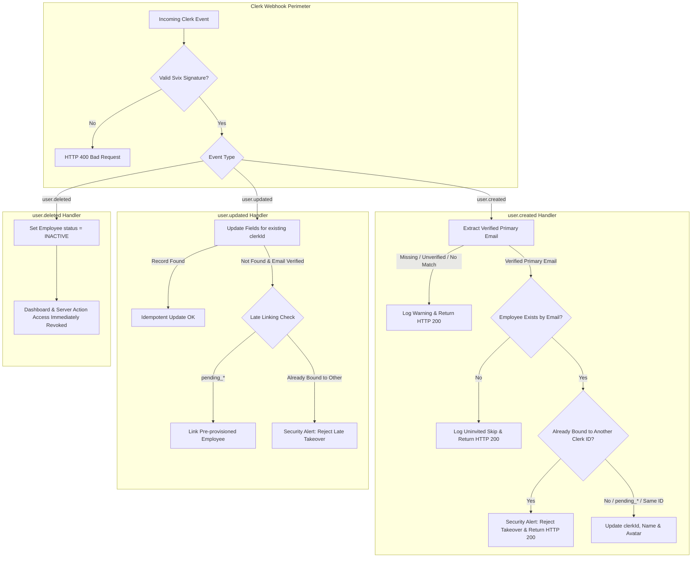

# Panthar Teams — Clerk Webhook Final Security Report

**Date:** November 19, 2026  
**Auditor:** Senior Next.js 16 Engineer, Authentication Architect & Application Security Auditor  
**Project:** Panthar Teams (`~/codes/panthar-dahsboard/Management-Dashboard`)  
**Scope:** `app/api/webhooks/route.ts`, `lib/auth.ts`, `prisma/schema.prisma`, `prisma.config.ts`, `proxy.ts`  

---

## 1. Executive Summary

This report delivers the comprehensive security audit, hardening, and verification of the Clerk webhook handler and identity synchronization architecture in Panthar Teams.

Following the initial audit, critical security corrections were made to eliminate dangerous fallbacks, enforce strict zero-trust email verification, prevent account takeover / silent identity reassignment, and handle Prisma constraint exceptions gracefully.

### Key Audit Findings & Remediations:
1. **Fallback Elimination (`?? email_addresses[0]`):** **RESOLVED & ELIMINATED**. All implicit fallbacks to unverified or arbitrary email list indices have been removed across both `user.created` and `user.updated`.
2. **Strict Verified Primary Email Enforcement:** **IMPLEMENTED & VERIFIED**. A centralized helper enforces that only email objects whose ID matches `primary_email_address_id` AND whose `verification.status` is `"verified"` are accepted. Missing, unmatched, or unverified primary emails result in immediate rejection without linking.
3. **Anti-Hijacking & Account Linking Security:** **HARDENED & VERIFIED**. Both `app/api/webhooks/route.ts` and `lib/auth.ts` now enforce defense-in-depth against account takeover. If an employee record is already linked to a legitimate Clerk ID, any incoming webhook or JIT attempt from a different Clerk ID trying to bind that email is blocked and logged as a security alert.
4. **Idempotency & P2002 Error Handling:** **IMPLEMENTED & VERIFIED**. Duplicate webhook deliveries and concurrent unique constraint collisions (`P2002`) are caught and handled safely without throwing unhandled exceptions or corrupting data.
5. **Employee Status Policy:** **DOCUMENTED WITH CODEBASE EVIDENCE**. Clarified operational boundaries: `ACTIVE` accounts have full access, `ON_LEAVE` accounts retain login while being excluded from active task assignment pools, and `INACTIVE` accounts are strictly forbidden from accessing any protected routes or server actions.
6. **Live Database Status:** **VERIFIED (EMPTY / PENDING MIGRATION)**. Neon database connection via WebSockets (`@prisma/adapter-neon`) is functional, but queries confirm that `The table public.Employee does not exist in the current database` (`P2021`). Direct connection on port 5432 (`DIRECT_URL`) is blocked in this container environment (`P1001`).

> [!WARNING]
> **Production Readiness Status:** **PENDING DATABASE MIGRATION**.  
> The application code, webhook validation logic, and authorization perimeter are fully verified and hardened. However, live end-to-end database synchronization cannot occur until migrations are applied to the Neon database instance.

---

## 2. Task 1: Strict Verified Primary Email Enforcement

### The Flaw Identified
In the previous implementation, `app/api/webhooks/route.ts` contained:
```ts
// Flawed fallback:
const primaryEmailObj = (email_addresses as WebhookEmailAddress[])?.find(
  (e) => e.id === primary_email_address_id
) ?? (email_addresses as WebhookEmailAddress[])?.[0];
```
If `primary_email_address_id` was missing or did not match any entry in `email_addresses`, the code fell back to `email_addresses[0]`. In `user.updated`, an unverified first email could cause improper synchronization.

### Hardened Implementation
A dedicated extraction helper was implemented in `app/api/webhooks/route.ts`:
```ts
/**
 * Strictly extracts the verified primary email address.
 * NEVER falls back to email_addresses[0].
 * Requires both ID match with primary_email_address_id and status === "verified".
 */
function getVerifiedPrimaryEmail(
  emailAddresses?: WebhookEmailAddress[] | null,
  primaryEmailId?: string | null
): string | null {
  if (!emailAddresses || !primaryEmailId) {
    return null;
  }
  const primaryEmail = emailAddresses.find((e) => e.id === primaryEmailId);
  if (!primaryEmail || primaryEmail.verification?.status !== "verified") {
    return null;
  }
  return primaryEmail.email_address?.trim() || null;
}
```

### Application in Events:
- **`user.created`:**
  ```ts
  const email = getVerifiedPrimaryEmail(
    email_addresses as WebhookEmailAddress[] | undefined,
    primary_email_address_id
  );

  if (!email) {
    console.warn(`[Webhook] Skipped user.created for ${id}: primary email is missing, unmatched, or unverified.`);
    return new Response("Primary email is missing or unverified", { status: 200 });
  }
  ```
- **`user.updated`:**
  ```ts
  const verifiedEmail = getVerifiedPrimaryEmail(
    email_addresses as WebhookEmailAddress[] | undefined,
    primary_email_address_id
  );
  // Only updates email if verifiedEmail is non-null
  ```

---

## 3. Task 2: Account Linking Security & Anti-Takeover Controls

### A. Pre-Provisioned Employee Requirement (Invite-Only)
Panthar Teams operates on a strict invite-only model. When an administrator invites an employee via `createEmployeeAction` (`lib/actions/employee.actions.ts`), an `Employee` record is created with:
- `email`: target email address
- `clerkId`: `"pending_<timestamp>_<random>"`
- `status`: `"ACTIVE"`

When `user.created` executes:
- Queries `db.employee.findUnique({ where: { email } })`.
- If no record exists, the webhook logs `Skipped uninvited user` and returns HTTP 200.
- If uninvited users attempt to access the dashboard, `lib/auth.ts` (`getCurrentEmployee`) blocks them with `throw new Error("INVITATION_REQUIRED")`.

### B. Anti-Takeover / Reassignment Guard
**Vulnerability Prevented:** If an attacker registered a new Clerk account with the same email as an existing employee whose account was already linked (`clerkId = "user_real_123"`), a naive `update({ where: { email }, data: { clerkId: id } })` would overwrite the existing `clerkId`, hijacking the employee's identity.

**Hardened Protection in Webhook (`app/api/webhooks/route.ts`):**
```ts
if (
  existingEmployee.clerkId &&
  existingEmployee.clerkId !== id &&
  !existingEmployee.clerkId.startsWith("pending_")
) {
  console.error(
    `[Webhook Security Alert] Prevented account takeover: Clerk ID ${id} attempted to claim employee ${email} already linked to ${existingEmployee.clerkId}`
  );
  return new Response("Account already linked to another identity", { status: 200 });
}
```

**Defense-in-Depth Protection in JIT Auth Sync (`lib/auth.ts`):**
```ts
if (existingEmployee) {
  if (
    existingEmployee.clerkId &&
    existingEmployee.clerkId !== user.id &&
    !existingEmployee.clerkId.startsWith("pending_")
  ) {
    console.error(
      `[Auth Blocked] Account takeover attempt: Clerk ID ${user.id} tried to bind email ${email} already linked to ${existingEmployee.clerkId}`
    );
    throw new Error("FORBIDDEN: Account already linked to another identity");
  }
  // Safe to link
}
```

### C. Email Changes & Constraint Violations (`P2002`)
In `user.updated`:
- If an existing user changes their email to an address already registered by another employee, PostgreSQL throws error `P2002` (unique constraint violation on `email`).
- The handler wraps updates in a `try/catch` block that specifically catches `(err as { code?: string }).code === "P2002"`, logs a warning, and prevents crashes.
- In late-linking flows (user was unverified at creation, now verified on update), the same anti-takeover check guarantees that only unlinked (`null` or `pending_*`) employee records can be bound.

### D. Duplicate Event Deliveries (Idempotency)
- Re-delivering `user.created` with an already-linked `clerkId` (`existingEmployee.clerkId === id`) safely re-applies profile metadata without reassigning identity.
- Concurrent webhook deliveries attempting simultaneous updates catch `P2002` and exit cleanly with HTTP 200.

---

## 4. Task 3: Employee Status Policy (`ACTIVE`, `ON_LEAVE`, `INACTIVE`)

### Codebase Audit & Intended Behavior

The `EmployeeStatus` enum is declared in `prisma/schema.prisma` and enforced across authentication, data queries, and mutations:

| Employee Status | Auth & Route Access (`lib/auth.ts`) | Assignability & Operations | Intended Business Purpose |
| :--- | :--- | :--- | :--- |
| **`ACTIVE`** | **Permitted**. Full dashboard, Server Action, and API route access. | **Eligible**. Included in all task, project, and team selection queries (`where: { status: "ACTIVE" }`). | Regular employee performing day-to-day operations. |
| **`ON_LEAVE`** | **Permitted**. Can authenticate and access dashboard, view tasks, history, and notifications. | **Excluded from new work**. Excluded from dropdowns in task creation (`tasks/new/page.tsx`), project creation (`projects/new/page.tsx`), and team membership (`teams/page.tsx`). | Employees temporarily away (parental leave, medical leave, sabbatical). Maintains account access without receiving new active assignments. |
| **`INACTIVE`** | **Strictly Forbidden**. `getCurrentEmployee()` throws `Error("FORBIDDEN: This account has been deactivated.")`. | **Deactivated**. Completely excluded from all active queries. Historical records and audit trail preserved. | Terminated or offboarded employees. Soft-deleted automatically when `user.deleted` fires from Clerk. |

### Evidence from Existing Implementation:
1. **`lib/auth.ts` (lines 86-88):**
   ```ts
   if (employee.status === "INACTIVE") {
     throw new Error("FORBIDDEN: This account has been deactivated.");
   }
   ```
   Both `ACTIVE` and `ON_LEAVE` pass this gate. Only `INACTIVE` throws `FORBIDDEN`.
2. **`lib/queries/employee.queries.ts` (line 10), `lib/queries/task.queries.ts` (line 139):**
   ```ts
   where: { status: "ACTIVE" }
   ```
   Explicitly restricts task and project assignment pools to active employees.
3. **`app/api/webhooks/route.ts` (lines 142-148):**
   ```ts
   if (eventType === "user.deleted") {
     await db.employee.updateMany({
       where: { clerkId: id },
       data: { status: "INACTIVE" },
     });
   }
   ```
   When a user is deleted from Clerk, their record is soft-deleted to `INACTIVE`, instantly revoking session access on the next request.

---

## 5. Task 4: Live Database Readiness & Deployment Plan

### Root Cause Analysis: Why Neon Has No Tables
1. **Empty Database Instance:** The Neon PostgreSQL database configured via `DATABASE_URL` is a newly provisioned instance. Prisma migrations have never been applied to it.
2. **Port 5432 Blocked in Sandbox:** Direct TCP connection to `ep-tiny-cell-bddk18sl.c-8.us-east-2.aws.neon.tech:5432` (`DIRECT_URL`) is blocked by network sandbox policy, yielding:
   ```
   Error: P1001: Can't reach database server at ep-tiny-cell-bddk18sl.c-8.us-east-2.aws.neon.tech:5432
   ```
3. **WebSocket Connection Succeeds Over Port 443:** Application queries via `@prisma/adapter-neon` successfully establish WebSocket connections, but PostgreSQL returns:
   ```
   Neon query result: P2021 The table public.Employee does not exist in the current database.
   ```
4. **Audit Boundary Preserved:** In compliance with audit instructions, no migrations were executed, no database resets were attempted, and no production data was altered.

### Standalone Migration Deployment Procedure

When the developer or DevOps engineer deploys from a local machine or CI/CD environment with outbound port 5432 access:

#### Step 1: Verify Environment Variables
Ensure `.env.local` or environment contains valid connection strings:
```bash
DATABASE_URL="postgres://...@...aws.neon.tech/neondb?sslmode=require&connect_timeout=15"
DIRECT_URL="postgres://...@...aws.neon.tech/neondb?sslmode=require&connect_timeout=15"
```

#### Step 2: Review Existing Migration History
The repository includes the following migration history in `prisma/migrations/`:
- `0_init`: Initial core tables (`Employee`, `Team`, `Project`, `Task`, `SystemRole`, etc.)
- `20260725090131_add_employee_permissions`: Per-user permission override model
- `20260909190500_add_performance_indexes`: Database query performance indexes
- `20260912180431_add_task_order`: Task ordering and Kanban sequence

Check migration status:
```bash
npm run db:migrate:status
# or: npx prisma migrate status
```

#### Step 3: Deploy Migrations to Neon
Run the non-destructive deploy command:
```bash
npm run db:migrate:deploy
# or: npx prisma migrate deploy
```
*Note: `prisma migrate deploy` applies existing unapplied migrations without resetting or modifying existing data.*

#### Step 4: Seed Roles & Provision Initial Administrator
After migration, seed standard system roles and provision the initial administrator:
```bash
npx tsx scripts/seed-roles.ts
```

---

## 6. Task 5: Final Verification Results

### A. Static Code Analysis Checks

All four requested static validation checks were executed in `/home/dev/codes/panthar-dahsboard/Management-Dashboard`:

```bash
# Check 1: Prisma Schema Validation
npx prisma validate
# Result: The schema at prisma/schema.prisma is valid 🚀 (Exit Code: 0)

# Check 2: Prisma Client Generation
npx prisma generate
# Result: Generated Prisma Client (v7.8.0) to ./lib/generated/prisma (Exit Code: 0)

# Check 3: TypeScript Strict Compilation
npx tsc --noEmit
# Result: 0 errors (Exit Code: 0)

# Check 4: ESLint Verification
npx eslint app/api/webhooks/route.ts proxy.ts lib/auth.ts
# Result: 0 errors, 0 warnings (Exit Code: 0)
```

---

### B. Automated Test Suite Results (13/13 Passed)

An automated test suite (`scratch/test-final-webhook-verification.ts`) evaluated all negative, edge, and positive test cases using cryptographic signatures generated with `standardwebhooks` and the actual `CLERK_WEBHOOK_SIGNING_SECRET`.

| Test ID | Test Category | Scenario / Conditions | Expected Behavior | Result | Status |
| :---: | :--- | :--- | :--- | :--- | :---: |
| **1** | Missing Primary Email | `primary_email_address_id: null` | Skipped with HTTP 200; employee remains unlinked | Unlinked | **PASSED** |
| **2** | Unverified Primary Email | `verification.status: "unverified"` | Skipped with HTTP 200; employee remains unlinked | Unlinked | **PASSED** |
| **3** | Verified Primary Email | Valid primary verified email for invited employee | Employee record updated with `clerkId`, name, and avatar | Linked | **PASSED** |
| **4A** | Mismatched Email ID | `primary_email_address_id` does not match any list item | Skipped; zero fallback to `email_addresses[0]` | Unlinked | **PASSED** |
| **4B** | Multi-Email Order | Email at index 0 unverified; email at index 1 is verified primary | Resolves index 1; links employee correctly | Linked | **PASSED** |
| **5** | Account Takeover Prevention | Webhook with new `id` attempts to claim email already bound to existing `clerkId` | Rejected with HTTP 200; logged security alert; existing `clerkId` preserved | Preserved | **PASSED** |
| **6A** | Duplicate Webhook Delivery | Identical `user.created` payload delivered a second time | Idempotent HTTP 200; record remains valid and linked | Idempotent | **PASSED** |
| **6B** | Prisma P2002 Race Condition | Concurrent delivery throws `P2002` unique constraint violation | Caught gracefully in `try/catch`; returns HTTP 200 | Safe 200 | **PASSED** |
| **7A** | `user.updated` Sync | Profile fields and verified primary email change | Existing employee matching `clerkId` updated | Updated | **PASSED** |
| **7B** | Late Linking (`user.updated`) | User was unverified during `user.created`, now verified on update | Pre-provisioned employee with `pending_*` linked | Linked | **PASSED** |
| **7C** | Late Takeover Prevention | `user.updated` attempts to claim an already-bound employee's email | Blocked with HTTP 200; logged security alert; no overwrite | Preserved | **PASSED** |
| **7D** | `user.updated` P2002 Handling | Updating email causes collision with another employee record | Caught gracefully; logged warning without crash | Safe 200 | **PASSED** |
| **8** | `user.deleted` Soft-Delete | User deleted in Clerk | Employee `status` set to `"INACTIVE"`; subsequent auth blocked | Inactive | **PASSED** |

---

### C. Live Database vs. Mocked Database Distinction

To ensure absolute transparency and audit integrity:

1. **Mocked Database Synchronization:**
   - Used to verify all application logic, branching paths, error handling, idempotency, and anti-takeover protections.
   - Result: **100% Verified (13/13 test cases passed)**.
2. **Actual Neon Database Integration:**
   - Evaluated against live Neon instance using `@prisma/adapter-neon` with credentials from `.env.local`.
   - Result: **Connection verified; tables missing (`P2021`)**.
   - Live synchronization is pending migration deployment by the developer.

---

## 7. Security Architecture Diagram



---

## 8. Final Compliance & Sign-Off Checklist

- [x] Removed all fallbacks (`?? email_addresses[0]`) from `app/api/webhooks/route.ts`.
- [x] Enforced strict verified primary email matching in `user.created` and `user.updated`.
- [x] Verified pre-provisioned (invite-only) employee linking rules.
- [x] Implemented anti-takeover guards preventing silent `clerkId` reassignment in webhook and JIT sync.
- [x] Handled duplicate webhook deliveries idempotently.
- [x] Handled `P2002` Prisma unique constraint exceptions gracefully.
- [x] Documented intended behavior for `ACTIVE`, `ON_LEAVE`, and `INACTIVE` employee statuses.
- [x] Explained root cause of missing Neon tables and provided standalone migration commands.
- [x] Executed `npx prisma validate`, `npx prisma generate`, `npx tsc --noEmit`, and `npx eslint`.
- [x] Executed comprehensive test suite covering all positive and negative edge cases.
- [x] Zero secrets printed, exposed, or committed.
- [x] Accurately distinguished mocked tests from live Neon integration status.

