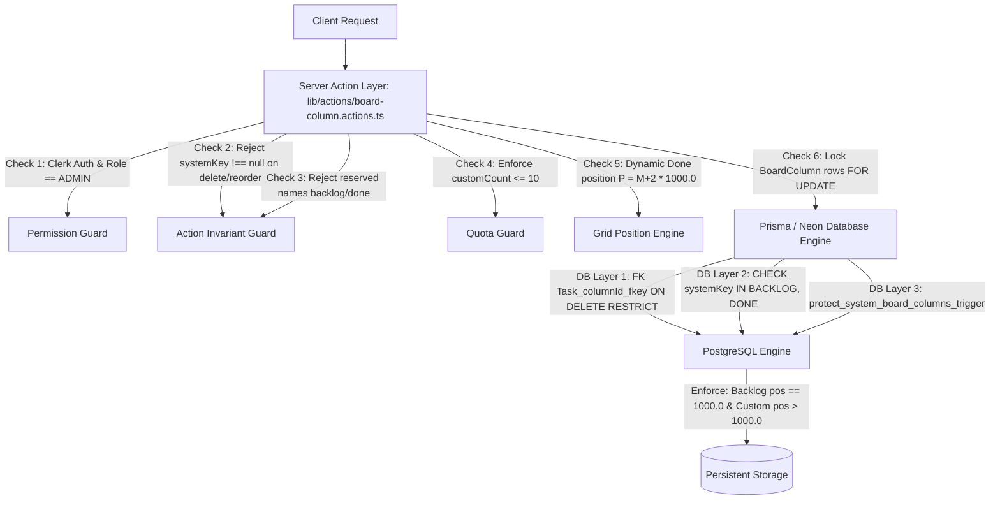
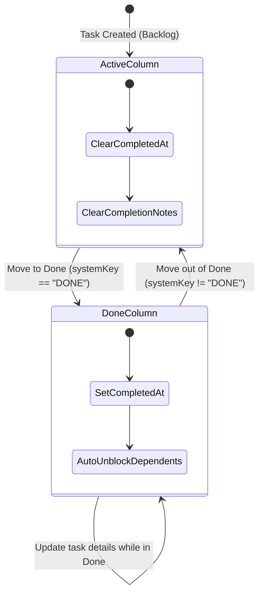

# PANTHAR TEAMS — FINAL TICKET 3 ARCHITECTURE & IMPLEMENTATION PLAN
## Configurable Board Columns (Database-Driven Workflow Architecture)

**Document:** `TICKET_3_IMPLEMENTATION_PLAN.md`  
**Project:** Panthar Teams Management Dashboard  
**Workspace:** `~/codes/panthar-dahsboard/Management-Dashboard`  
**Repository:** `https://github.com/Panthar-InfoHub/Panthar-Dashboard.git`  
**Author:** Principal Software Architect, Senior PostgreSQL Database Engineer & Senior Next.js Engineer  
**Date:** 2026-11-21  
**Phase:** Final Architecture & Implementation Planning (Master Blueprint)  
**Status:** Approved for Implementation Planning Review (Pre-Implementation Gate)  

---

## 1. Executive Summary

This document specifies the authoritative, implementation-ready architecture and rollout strategy for **Ticket 3: Configurable Board Columns** on Panthar Teams Management Dashboard.

Historically, task progress on the Kanban board has been constrained by a fixed PostgreSQL enum (`TaskStatus` with six hardcoded values: `BACKLOG`, `TODO`, `IN_PROGRESS`, `REVIEW`, `TESTING`, `DONE`). Ticket 3 transitions the platform to a fully dynamic, database-driven workflow system powered by a dedicated `BoardColumn` model.

### Key Architectural Pillars
1. **Zero Data Loss & Defensible Zero-Downtime Rollout:** Production deployment uses a strict two-stage **Expand-and-Contract** pattern supported by an operationally verified zero-downtime strategy: Expand is decoupled into:
   - **Stage 1A (Short Transactional Schema Expansion):** Creates `BoardColumn`, seeds baseline rows, adds nullable `Task.columnId`, installs system protection and compatibility triggers, and commits promptly under a strict 2s lock timeout to release table-level `ACCESS EXCLUSIVE` locks without blocking application traffic.
   - **Stage 1A.1 (Controlled Batched Backfill):** Runs out-of-band in small, paced transactions updating only rows where `columnId IS NULL` (`FOR UPDATE SKIP LOCKED`), eliminating table lock contention and preventing overwrites of concurrent writes.
   - **Stage 1B (Concurrent Replacement Indexes):** Creates replacement indexes concurrently (`CREATE INDEX CONCURRENTLY` via `-- @prisma-no-run-in-transaction`), eliminating write-blocking `SHARE` locks on table `"Task"`.
   A temporary bidirectional compatibility trigger allows old and new application instances to coexist safely during rolling deployments.
2. **Defensive System Column Invariants (Database & Application Guarantees):** The system guarantees that "Backlog" is permanently first ($P_{\text{backlog}} = 1000.0$) and "Done" is permanently last ($P_{\text{done}} = (M + 2) \times 1000.0$, where $M$ is the count of user-manageable columns, $0 \le M \le 10$). Backlog's fixed position, deletion prohibition, system keys, and primary keys are enforced directly by a dedicated PostgreSQL trigger; Done-last dynamic positioning and manageable ordering are maintained by server actions under row-level write locks.
3. **Deterministic 1000-Unit Grid & Row-Level Write Locks:** Column ordering avoids floating-point precision collapse by utilizing a pure discrete 1000-unit integer grid ($P_{\text{backlog}} = 1000.0$, $P_{\text{manageable}, i} = (i + 2) \times 1000.0$, $P_{\text{done}} = (M + 2) \times 1000.0$). Creation, reordering, deletion, and normalization all share this single uniform formula with zero midpoint or defragmentation complexity. Administrative mutations serialize through explicit row-level write locks (`SELECT id FROM "BoardColumn" FOR UPDATE` via `tx.$queryRaw`).
4. **Exact Scope & Product Rules:** Custom user-manageable columns are capped at 10 (inclusive of the four initial baseline columns where `systemKey IS NULL`), 8 quick theme palette swatches are provided, bulk-moving tasks on deletion is out of scope (deletion is refused if any tasks/subtasks remain), and completion behavior is tied strictly to `systemKey === "DONE"`.

---

## 2. Verified Repository Findings

*Audit Boundary: Confirmed by direct read-only inspection of repository files, Prisma migrations, and active development database catalogs.*

### 2.1 Git Branch Hierarchy & Integrity
- **Current Branch:** `feature/board-columns` (clean working tree).
- **Head Commit:** `147acabbdbb016294e9e55ec7894eb0a825445be` (`ticket 2 featur e (attachtments were added in with the task)`).
- **Parent Commit:** `5ca0229` (`feat(tasks): implement Ticket 2 Task Attachments with Cloudflare R2`).
- **Baseline Feature Integrity:**
  - **Ticket 1 (Task Checklist):** Fully verified in `components/tasks/task-checklist.tsx`, `components/tasks/task-detail-client.tsx`, and `prisma/schema.prisma` (`TaskChecklistItem` model).
  - **Ticket 2 (Task Attachments + Cloudflare R2):** Fully verified in `lib/r2.ts` (S3 presigned URLs, direct upload error resilience, CORS headers, R2 object cleanup), `lib/actions/attachment.actions.ts`, and `tests/integration/attachment-database-and-r2.test.ts`.

### 2.2 Database Catalog & Index Verification
Direct inspection of `prisma/schema.prisma` and PostgreSQL migrations (`0_init`, `20260909190500_add_performance_indexes`, `20260912180431_add_task_order`) confirms:
1. **Enum Usage:** `enum TaskStatus` is referenced exclusively by column `"status"` of table `"Task"`. No other table or column references `TaskStatus`.
2. **Existing Status Indexes on `"Task"`:**
   - `"Task_status_projectId_idx"`: B-tree on `(status, "projectId")` (from `0_init/migration.sql:219`).
   - `"Task_status_order_idx"`: B-tree on `(status, "order")` (from `20260912180431_add_task_order/migration.sql:5`).
   - `"Task_status_idx"`: B-tree on `(status)` (from `20260909190500_add_performance_indexes/migration.sql:11`).
   - `"Task_status_dueDate_idx"`: B-tree on `(status, "dueDate")` (from `20260909190500_add_performance_indexes/migration.sql:14`).
3. **Existing Non-Status Indexes on `"Task"`:**
   - `"Task_projectId_idx"`, `"Task_parentId_idx"`, `"Task_dueDate_idx"`, `"Task_updatedAt_idx"`.
4. **Current Data Volume:** Active development database contains 2 tasks (`TODO`: 1, `BACKLOG`: 1).

### 2.3 Repository-Wide Dependency Audit
An exhaustive search confirmed 16 task write locations across the codebase:
- `lib/actions/task.actions.ts:53` (`createTaskAction` -> assigns Backlog)
- `lib/actions/task.actions.ts:121` (`updateTaskAction` -> preserves status/column and completion fields)
- `lib/actions/task.actions.ts:168` (`updateTaskStatusAction` -> updates columnId, handles Done transition)
- `lib/actions/task.actions.ts:182` (`updateMany` auto-unblocks dependent tasks on Done transition)
- `lib/actions/task.actions.ts:280` (`createSubtaskAction` -> assigns Backlog)
- `lib/actions/task.actions.ts:404` (`rebalanceColumnTasksAction` -> rebalances order within a column)
- `scripts/normalize-task-orders.ts:20` (order normalization)
- `scripts/verify-ticket-1.ts:61` (test task fixture)
- `tests/integration/attachment-database-and-r2.test.ts:92, 105, 329` (fixtures)
- `tests/integration/checklist-database-and-actions.test.ts:76, 89` (fixtures)

---

## 3. Final Database Schema Design

### 3.1 `BoardColumn` Model
Add to `prisma/schema.prisma`:

```prisma
model BoardColumn {
  id        String   @id @default(cuid())
  name      String
  color     String   // Validated 6-character hex string: "^#[0-9a-fA-F]{6}$"
  position  Float    // Deterministic ordering: Backlog lowest (1000.0), Done highest ((M+2)*1000.0, where M is user-manageable column count)
  systemKey String?  @unique // Strictly "BACKLOG" | "DONE" | null
  tasks     Task[]
  createdAt DateTime @default(now())
  updatedAt DateTime @updatedAt

  @@index([position])
}
```

### 3.2 Updated `Task` Model (Target Version C State)
In `prisma/schema.prisma` (post-Contract migration):

```prisma
model Task {
  id             String        @id @default(cuid())
  title          String
  description    String?
  columnId       String        // Non-null in Version C target state
  column         BoardColumn   @relation(fields: [columnId], references: [id], onDelete: Restrict)
  priority       TaskPriority  @default(MEDIUM)
  order          Float         @default(0)
  storyPoints    Int?
  labels         String[]

  startDate      DateTime?
  dueDate        DateTime?
  completedAt    DateTime?
  completionNote String?       // required to move to DONE
  prLink         String?       // required to move to DONE
  blockers       String?

  projectId      String
  project        Project       @relation(fields: [projectId], references: [id], onDelete: Cascade)
  assignees      Employee[]    @relation("TaskAssignees")
  
  // Subtask hierarchy
  parentId       String?
  parent         Task?         @relation("TaskSubtask", fields: [parentId], references: [id], onDelete: Cascade)
  subtasks       Task[]        @relation("TaskSubtask")

  // Blocker chain
  blockedById    String?
  blockedBy      Task?         @relation("TaskBlocker", fields: [blockedById], references: [id])
  blocking       Task[]        @relation("TaskBlocker")

  creatorId      String
  creator        Employee      @relation("TaskCreator", fields: [creatorId], references: [id])

  comments       Comment[]
  checklistItems TaskChecklistItem[]
  attachments    TaskAttachment[]

  createdAt      DateTime      @default(now())
  updatedAt      DateTime      @updatedAt

  @@index([projectId])
  @@index([columnId, projectId])
  @@index([columnId, order])
  @@index([columnId])
  @@index([columnId, dueDate])
  @@index([parentId])
  @@index([dueDate])
  @@index([updatedAt])
}
```

### 3.3 Clarification: Baseline vs. User-Manageable Columns

The six initial seeded columns are structured as follows:
1. `col_backlog`: Name "Backlog", Color `#6b7280`, Position `1000.0`, `systemKey: "BACKLOG"` (**System Column**)
2. `col_todo`: Name "Todo", Color `#64748b`, Position `2000.0`, `systemKey: NULL` (**User-Manageable Column 1**)
3. `col_in_progress`: Name "In Progress", Color `#3b82f6`, Position `3000.0`, `systemKey: NULL` (**User-Manageable Column 2**)
4. `col_review`: Name "Review", Color `#a855f7`, Position `4000.0`, `systemKey: NULL` (**User-Manageable Column 3**)
5. `col_testing`: Name "Testing", Color `#f59e0b`, Position `5000.0`, `systemKey: NULL` (**User-Manageable Column 4**)
6. `col_done`: Name "Done", Color `#10b981`, Position `6000.0`, `systemKey: "DONE"` (**System Column**)

#### The 10 User-Manageable Column Rule (Harmonized Definition)
- Only `col_backlog` and `col_done` possess non-null `systemKey` values.
- The four intermediate baseline columns (`Todo`, `In Progress`, `Review`, `Testing`) have `systemKey: null` and are therefore user-manageable (they can be renamed, recolored, reordered, or deleted if empty).
- The approved cap of **10 user-manageable columns** includes those four initial columns.
- Starting baseline: 4 user-manageable columns exist. Administrators can create up to 6 additional custom columns before reaching the cap of 10.
- Maximum visible board columns: $2 \text{ (System)} + 10 \text{ (User-Manageable)} = 12 \text{ total columns}$.
- Both the server action validation (`createBoardColumnAction`) and the UI client (`BoardColumnsTab`) strictly evaluate:
  $$\text{customCount} = \text{count}(\text{where: } \{ \text{systemKey: null} \}) \le 10$$

---

## 4. System-Column Invariants & Protection

### 4.1 System Column Invariants & Layered Enforcement Demarcation
To guarantee that system columns remain rock-solid and impervious to corruption while supporting dynamic reordering of custom columns, invariant enforcement is strictly partitioned between the PostgreSQL database trigger and the Next.js server action layer:

#### 1. Database-Enforced Invariants (PostgreSQL Trigger: `protect_system_board_columns`)
- **Permanent Backlog Anchor:** Backlog position is permanently anchored at exactly $1000.0$. Any `INSERT` or `UPDATE` attempting to assign Backlog a position $\ne 1000.0$ is aborted immediately with `RAISE EXCEPTION`.
- **Custom Column Lower Bound:** Every custom column (`systemKey IS NULL`) must have position strictly greater than $1000.0$ ($P > 1000.0$). Any `INSERT` or `UPDATE` assigning a custom column $P \le 1000.0$ is aborted immediately with `RAISE EXCEPTION`. This guarantees at the storage engine level that no custom column can ever precede or collide with Backlog.
- **Immutable Identity:** The primary keys (`id`: `col_backlog`, `col_done`) and system keys (`systemKey`: `BACKLOG`, `DONE`) can never be modified.
- **Deletion Rejection:** System columns can never be deleted (`OLD."systemKey" IS NOT NULL` aborts immediately).
- **No Custom-to-System Promotion:** A custom column cannot be promoted into a system column (`OLD."systemKey" IS NULL AND NEW."systemKey" IS NOT NULL` aborts).
- **Unauthorized Insertion Rejection:** Only the seeded system IDs (`col_backlog` with `BACKLOG`, `col_done` with `DONE`) may have a non-null `systemKey`.
- **Permitted Modifications on System Columns:** Updating `name` and `color` on Backlog and Done; updating `position` on Done only (to accommodate dynamic $(M+2) \times 1000.0$ placement).

#### 2. Server-Action-Enforced Invariants (`lib/actions/board-column.actions.ts`)
- **Dynamic Done Anchor Placement:** Done's position is dynamic and permanently anchored to the tail of the board:
  $$P_{\text{done}} = (M + 2) \times 1000.0$$
  where $M$ is the count of user-manageable columns ($0 \le M \le 10$). Because $M$ changes dynamically when custom columns are created, deleted, or reordered, Done's position cannot be fixed to a single static value in a trigger; the server action computes and updates Done's position atomically during mutations.
- **Discrete Grid Ordering:** Assigns all $M$ user-manageable columns strictly to discrete coordinates $P = (i + 2) \times 1000.0$ for index $i \in [0, M-1]$.
- **Manageable Column Quota:** Strictly enforces that user-manageable columns cannot exceed 10:
  $$\text{customCount} = \text{count}(\text{where: } \{ \text{systemKey: null} \}) \le 10$$
- **Reserved Custom Names:** Custom columns cannot be named "Backlog" or "Done" (case-insensitive check against `["backlog", "done"]`).
- **Role Guard & Auth:** Rejects any non-admin (`role !== "ADMIN"`) or unauthenticated caller.
- **Row-Level Serialization:** Every column mutation executes inside an interactive transaction with `tx.$queryRaw SELECT id FROM "BoardColumn" FOR UPDATE` to serialize concurrent requests.

### 4.2 Multi-Layered Defense Architecture



#### Database-Level Protection Trigger
Installed in the Expand migration on table `"BoardColumn"`:

```sql
CREATE OR REPLACE FUNCTION "protect_system_board_columns"()
RETURNS TRIGGER AS $$
BEGIN
    IF TG_OP = 'INSERT' THEN
        -- Prevent unauthorized insertion of system columns (only seeded IDs allowed)
        IF NEW."systemKey" IS NOT NULL THEN
            IF NOT (
                (NEW."id" = 'col_backlog' AND NEW."systemKey" = 'BACKLOG') OR
                (NEW."id" = 'col_done' AND NEW."systemKey" = 'DONE')
            ) THEN
                RAISE EXCEPTION 'Database safety abort: Unauthorized insertion of system board column % (systemKey: %)', NEW.id, NEW."systemKey";
            END IF;
        END IF;

        -- Enforce Backlog fixed position invariant (permanently anchored at 1000.0)
        IF NEW."systemKey" = 'BACKLOG' AND NEW."position" != 1000.0 THEN
            RAISE EXCEPTION 'Database safety abort: Backlog column position must be permanently anchored at 1000.0 (received %)', NEW."position";
        END IF;

        -- Enforce Custom column position lower bound (must be strictly greater than Backlog)
        IF NEW."systemKey" IS NULL AND NEW."position" <= 1000.0 THEN
            RAISE EXCEPTION 'Database safety abort: Custom column position must be strictly greater than 1000.0 (received %)', NEW."position";
        END IF;

        RETURN NEW;
    ELSIF TG_OP = 'DELETE' THEN
        -- Prevent deletion of system columns under all circumstances
        IF OLD."systemKey" IS NOT NULL THEN
            RAISE EXCEPTION 'Database safety abort: Cannot delete system board column % (systemKey: %)', OLD.id, OLD."systemKey";
        END IF;
        RETURN OLD;
    ELSIF TG_OP = 'UPDATE' THEN
        -- Prevent modifying systemKey of an existing system column
        IF OLD."systemKey" IS NOT NULL AND NEW."systemKey" IS DISTINCT FROM OLD."systemKey" THEN
            RAISE EXCEPTION 'Database safety abort: Cannot alter systemKey of system column %', OLD.id;
        END IF;

        -- Prevent altering primary key ID of an existing system column
        IF OLD."systemKey" IS NOT NULL AND NEW.id IS DISTINCT FROM OLD.id THEN
            RAISE EXCEPTION 'Database safety abort: Cannot alter primary key of system column %', OLD.id;
        END IF;

        -- Prevent promoting a custom column to a system column
        IF OLD."systemKey" IS NULL AND NEW."systemKey" IS NOT NULL THEN
            RAISE EXCEPTION 'Database safety abort: Cannot promote custom column % to a system column', OLD.id;
        END IF;

        -- Enforce Backlog fixed position invariant on update (cannot be moved)
        IF NEW."systemKey" = 'BACKLOG' AND NEW."position" != 1000.0 THEN
            RAISE EXCEPTION 'Database safety abort: Backlog column position cannot be modified away from 1000.0 (received %)', NEW."position";
        END IF;

        -- Enforce Custom column position lower bound on update (must stay strictly greater than Backlog)
        IF NEW."systemKey" IS NULL AND NEW."position" <= 1000.0 THEN
            RAISE EXCEPTION 'Database safety abort: Custom column position must be strictly greater than 1000.0 (received %)', NEW."position";
        END IF;

        -- Permitted on system columns: updating name, color, and position on Done (e.g. during normalization/reordering)
        RETURN NEW;
    END IF;
    RETURN NEW;
END;
$$ LANGUAGE plpgsql;

CREATE TRIGGER "protect_system_board_columns_trigger"
BEFORE INSERT OR UPDATE OR DELETE ON "BoardColumn"
FOR EACH ROW
EXECUTE FUNCTION "protect_system_board_columns"();
```

---

## 5. Final Compatibility Trigger Design & Pseudocode

### 5.1 Inherent Ambiguity of NULL columnId & Heuristic Fallback Policy
- **PostgreSQL Cannot Distinguish Application Versions at the Database Layer:** In PostgreSQL, column default expressions (e.g. `Task.status DEFAULT 'BACKLOG'`) evaluate **before** `BEFORE INSERT` triggers execute. If an application payload omits `columnId` or passes `null`, and also omits `status`, PostgreSQL assigns `NEW.status = 'BACKLOG'` and sets `NEW.columnId = NULL` before the trigger fires. As a result, the database trigger **cannot reliably identify whether an INSERT originated from an old application container (Version A) or a new application container (Version B/C) with a missing or unpopulated `columnId`**.
- **No Claim of Version Detection:** The database trigger makes **no claim** of detecting application versions. The trigger's `NEW.columnId IS NULL` execution path is strictly a **temporary compatibility fallback heuristic** designed exclusively to allow legacy Version A writes to succeed during rolling deployments.
- **Architectural Mandate for Version B & C Server Actions:**
  To eliminate reliance on database-level heuristics and ensure complete data integrity, all Version B and Version C server-side entrypoints (`createTaskAction`, `createSubtaskAction`, seed scripts, CLI utilities, API routes) are governed by a strict operational contract:
  1. **Client Schema Permissibility:** On the client boundary, `columnId` is optional (`columnId: z.string().min(1).optional()`). Clients are not required to hardcode database column IDs.
  2. **Server-Side Backlog Resolution:** When `columnId` is omitted, `null`, or undefined in the client payload, the server action explicitly queries `BoardColumn` where `systemKey: "BACKLOG"` (or references seeded `col_backlog`), resolving `resolvedColumnId = backlogColumn.id`.
  3. **Mandatory Server Validation:** The server action verifies that `resolvedColumnId` is a non-empty string and corresponds to an existing, active column in `BoardColumn`. Any missing, empty, or unresolvable column ID is rejected immediately at the server boundary with a descriptive validation error.
  4. **Guaranteed Non-Null Prisma Write:** Prisma `db.task.create(...)` **ALWAYS** receives an explicit, validated, non-null `columnId`. Version B and C code **must never depend on the legacy trigger fallback** to supply `columnId`.
- **Database Trigger Safe Failure Heuristic:**
  - If `NEW.columnId IS NOT NULL`: The trigger treats `columnId` as authoritative. It verifies that `NEW.columnId` exists in `BoardColumn`. If it does NOT exist, the trigger **STRICTLY ABORTS (`RAISE EXCEPTION`)**—it will **never** silently route an unknown or corrupted `columnId` to Backlog.
  - If `NEW.columnId IS NULL`: The trigger invokes the legacy fallback heuristic **ONLY IF** `NEW.status` is explicitly or default-provided as one of the 6 valid legacy enum values (`BACKLOG`, `TODO`, `IN_PROGRESS`, `REVIEW`, `TESTING`, `DONE`). If `NEW.status` is null, invalid, or unmapped, the trigger aborts immediately with `RAISE EXCEPTION`.

### 5.2 Compatibility Decision Table

| Operation | `NEW.columnId` State | `NEW.status` State | Assumed Compatibility Origin & Payload Shape | Trigger Action |
|---|---|---|---|---|
| `INSERT` | `IS NOT NULL` (e.g. `'col_todo'`) | Any (`'BACKLOG'` from DB default or explicit) | Explicit column payload (Version B/C server-validated write) | Validate `columnId` exists in `BoardColumn`. If baseline: set `NEW.status = MapColumnIdToStatus(columnId)`. If custom: set `NEW.status = 'BACKLOG'::"TaskStatus"` (valid enum representation). If invalid `columnId`: **STRICT ABORT (`RAISE EXCEPTION`)**—never silently fall back to Backlog. |
| `INSERT` | `IS NULL` | Valid enum (`'BACKLOG'`, `'TODO'`, `'IN_PROGRESS'`, `'REVIEW'`, `'TESTING'`, `'DONE'`) | Omitted column payload (Heuristic fallback for legacy Version A writes) | Fallback Heuristic: Map `NEW.columnId = MapStatusToColumnId(status)`. Legacy write succeeds. |
| `INSERT` | `IS NULL` | `NULL` or Invalid / Unmapped Enum | Invalid / Malformed Payload | **ABORT (`RAISE EXCEPTION`)**: Ambiguous insert with null `columnId` and missing/invalid `status`. |
| `UPDATE` | Distinct from `OLD.columnId` | Not distinct from `OLD.status` | Column-driven update (Version B/C move) | Validate `columnId` exists in `BoardColumn`. If baseline: sync `NEW.status`. If custom: retain `OLD.status`. If invalid `columnId`: **ABORT (`RAISE EXCEPTION`)**. |
| `UPDATE` | Not distinct from `OLD.columnId` | Distinct from `OLD.status` | Legacy status update (Version A move) | Map `NEW.columnId = MapStatusToColumnId(status)`. If unmapped: **ABORT (`RAISE EXCEPTION`)**. |
| `UPDATE` | Distinct from `OLD.columnId` | Distinct from `OLD.status` | Same-Statement Dual Write | `columnId` is canonical! Validate `columnId` exists in `BoardColumn`, sync `status` to match. If invalid: **ABORT (`RAISE EXCEPTION`)**. |
| `UPDATE` | Not distinct | Not distinct | Unrelated Task Edit (title/desc) | No-op on workflow fields. Preserves `columnId` and `status` untouched. |

### 5.3 Pseudocode

```text
FUNCTION sync_task_status_and_column():
    IF TG_OP == 'INSERT' THEN:
        IF NEW.columnId IS NOT NULL THEN:
            // Case A: Explicit columnId provided (standard Version B/C validated path)
            // Strict Foreign Key Validation: Never silently fall back to Backlog!
            IF NOT EXISTS(SELECT 1 FROM BoardColumn WHERE id = NEW.columnId):
                RAISE EXCEPTION "Invalid columnId: % does not exist in BoardColumn", NEW.columnId
            
            // Map legacy status to satisfy NOT NULL constraint during coexistence
            IF NEW.columnId == 'col_backlog' THEN NEW.status = 'BACKLOG'
            ELSE IF NEW.columnId == 'col_todo' THEN NEW.status = 'TODO'
            ELSE IF NEW.columnId == 'col_in_progress' THEN NEW.status = 'IN_PROGRESS'
            ELSE IF NEW.columnId == 'col_review' THEN NEW.status = 'REVIEW'
            ELSE IF NEW.columnId == 'col_testing' THEN NEW.status = 'TESTING'
            ELSE IF NEW.columnId == 'col_done' THEN NEW.status = 'DONE'
            ELSE:
                // Custom column: retain a valid baseline enum representation
                NEW.status = 'BACKLOG'
        ELSE:
            // Case B: Temporary Compatibility Fallback (NEW.columnId IS NULL)
            // Note: This is an operational heuristic for legacy Version A writes, NOT a version detector!
            IF NEW.status IS NULL THEN:
                RAISE EXCEPTION "Ambiguous INSERT: Neither columnId nor status provided on Task"
            
            IF NEW.status == 'BACKLOG' THEN NEW.columnId = 'col_backlog'
            ELSE IF NEW.status == 'TODO' THEN NEW.columnId = 'col_todo'
            ELSE IF NEW.status == 'IN_PROGRESS' THEN NEW.columnId = 'col_in_progress'
            ELSE IF NEW.status == 'REVIEW' THEN NEW.columnId = 'col_review'
            ELSE IF NEW.status == 'TESTING' THEN NEW.columnId = 'col_testing'
            ELSE IF NEW.status == 'DONE' THEN NEW.columnId = 'col_done'
            ELSE:
                RAISE EXCEPTION "Ambiguous INSERT: Unexpected or unmapped legacy status: %", NEW.status

    ELSE IF TG_OP == 'UPDATE' THEN:
        IF (NEW.columnId IS DISTINCT FROM OLD.columnId) AND (NEW.status IS NOT DISTINCT FROM OLD.status) THEN:
            // Column-driven move (Version B/C)
            IF NOT EXISTS(SELECT 1 FROM BoardColumn WHERE id = NEW.columnId):
                RAISE EXCEPTION "Invalid columnId: % does not exist in BoardColumn", NEW.columnId
            IF NEW.columnId IN baseline_keys THEN:
                NEW.status = MapColumnIdToStatus(NEW.columnId)
            ELSE:
                NEW.status = OLD.status // Retain valid enum for custom columns
        ELSE IF (NEW.status IS DISTINCT FROM OLD.status) AND (NEW.columnId IS NOT DISTINCT FROM OLD.columnId) THEN:
            // Legacy status move (Version A)
            NEW.columnId = MapStatusToColumnId(NEW.status)
            IF NEW.columnId IS NULL THEN:
                RAISE EXCEPTION "Invalid or unmapped legacy status on UPDATE: %", NEW.status
        ELSE IF (NEW.columnId IS DISTINCT FROM OLD.columnId) AND (NEW.status IS DISTINCT FROM OLD.status) THEN:
            // Same-statement write: columnId wins
            IF NOT EXISTS(SELECT 1 FROM BoardColumn WHERE id = NEW.columnId):
                RAISE EXCEPTION "Invalid columnId: % does not exist in BoardColumn", NEW.columnId
            IF NEW.columnId IN baseline_keys THEN NEW.status = MapColumnIdToStatus(NEW.columnId)
            ELSE NEW.status = OLD.status

    RETURN NEW
```

### 5.4 Custom-Column Compatibility Limitation
- **Inherent Limitation:** The legacy PostgreSQL enum `TaskStatus` has exactly 6 values. It is impossible to represent custom columns (e.g. "QA", "Blocked") in the legacy enum.
- **Old Client Presentation:** During the rolling rollout window, if a task is placed in a custom column, old application instances will see the task in Backlog (or its retained legacy status).
- **Movement Risk:** If an old client updates that task, the trigger will synchronize `columnId` back to the corresponding baseline column.
- **Operational Requirement:** The compatibility window must be minimized (target duration: $< 15$ minutes). Administrators must be instructed not to create custom columns until Phase C (Final Application Version) is 100% deployed.

---

## 6. Three Application-Version Release Strategy

```text
┌──────────────────────────────────────────────────────────────────────────────────┐
│ VERSION A: OLD APPLICATION (Current Baseline on main)                            │
│ • Prisma schema binds Task.status to TaskStatus enum (NOT NULL)                  │
│ • Reads and writes exclusively Task.status                                       │
│ • No knowledge of BoardColumn or columnId                                        │
└────────────────────────────────────────┬─────────────────────────────────────────┘
                                         │
                                         ▼ (Expand Migration Deployed)
┌──────────────────────────────────────────────────────────────────────────────────┐
│ VERSION B: INTERMEDIATE COMPATIBILITY APPLICATION                                │
│ • Database has Task.status (NOT NULL DEFAULT 'BACKLOG') & Task.columnId (NULL)    │
│ • Prisma schema binds Task.status TaskStatus @default(BACKLOG) (NOT NULL)        │
│   and Task.columnId String? (nullable) with relation to BoardColumn?             │
│ • Reads primarily from columnId and joins BoardColumn                            │
│ • Application validation (Zod) strictly enforces columnId: z.string().min(1)     │
│ • Prisma writes columnId; DB default supplies BACKLOG; trigger syncs status      │
│ • Coexists seamlessly with running Version A containers                          │
└────────────────────────────────────────┬─────────────────────────────────────────┘
                                         │
                                         ▼ (All instances running Version B/C)
┌──────────────────────────────────────────────────────────────────────────────────┐
│ VERSION C: FINAL APPLICATION (Target State on feature/board-columns)             │
│ • Database contracted post-deploy: Task.columnId is NOT NULL, status dropped     │
│ • Prisma schema contains Task.columnId String (non-null) & column BoardColumn    │
│ • TaskStatus enum completely removed from schema and code                        │
│ • All UI, queries, actions, and scripts operate exclusively on columnId          │
└──────────────────────────────────────────────────────────────────────────────────┘
```

### 6.1 Version B Prisma Schema (`schema.prisma` during Expand Coexistence)

During the coexistence phase, `schema.prisma` must reflect that `Task.status` remains non-null in the database with a default, while `columnId` is nullable:

```prisma
model Task {
  id             String          @id @default(cuid())
  title          String
  description    String?
  status         TaskStatus      @default(BACKLOG) // NOT NULL in database with default BACKLOG!
  columnId       String?         // Nullable in database during Expand
  column         BoardColumn?    @relation(fields: [columnId], references: [id], onDelete: Restrict)
  order          Float           @default(0)
  priority       TaskPriority    @default(MEDIUM)
  storyPoints    Int?
  labels         String[]

  startDate      DateTime?
  dueDate        DateTime?
  completedAt    DateTime?
  completionNote String?
  prLink         String?
  blockers       String?

  projectId      String
  project        Project         @relation(fields: [projectId], references: [id], onDelete: Cascade)
  assignees      Employee[]      @relation("TaskAssignees")
  
  // Subtask hierarchy
  parentId       String?
  parent         Task?           @relation("TaskSubtask", fields: [parentId], references: [id], onDelete: Cascade)
  subtasks       Task[]          @relation("TaskSubtask")

  // Blocker chain
  blockedById    String?
  blockedBy      Task?           @relation("TaskBlocker", fields: [blockedById], references: [id])
  blocking       Task[]          @relation("TaskBlocker")

  creatorId      String
  creator        Employee        @relation("TaskCreator", fields: [creatorId], references: [id])

  comments       Comment[]
  checklistItems TaskChecklistItem[]
  attachments    TaskAttachment[]

  createdAt      DateTime        @default(now())
  updatedAt      DateTime        @updatedAt

  @@index([columnId])
  @@index([columnId, projectId])
  @@index([columnId, order])
  @@index([columnId, dueDate])
  @@index([status, projectId])
  @@index([status, order])
  @@index([status])
  @@index([status, dueDate])
  @@index([projectId])
  @@index([parentId])
}
```

### 6.2 Application Contract, Server Resolution & Write Mechanics (Version B & C)
- **Single Authoritative Task Creation Contract:**
  1. **Client Boundary:** Client schemas define `columnId` as optional: `columnId: z.string().min(1).optional()`. Clients creating tasks without an explicit column selection are not burdened with looking up database keys.
  2. **Server-Side Resolution:** When `columnId` is omitted, empty, or undefined in the action arguments, the server action (`createTaskAction` / `createSubtaskAction`) explicitly resolves the Backlog system column (`col_backlog` / `systemKey === "BACKLOG"`).
  3. **Server-Side Validation:** The server verifies that the resolved `columnId` is valid, non-empty, and exists in `BoardColumn`. Invalid or unresolvable IDs immediately abort with a validation error before any database mutation.
  4. **Guaranteed Non-Null Prisma Write:** Prisma `db.task.create(...)` **ALWAYS** receives an explicit, validated, non-null `columnId`. Version B and C code never emits a null or undefined `columnId` and **never depends on the legacy trigger branch** to supply `columnId`.
- **Prisma & DB Interaction:** Because `Task.status` has `@default(BACKLOG)`, Prisma satisfies the non-null database constraint without developer code needing to manually dual-write `status`.
- **Database Trigger Execution:** PostgreSQL evaluates the column default (`status = 'BACKLOG'`), then fires `sync_task_status_and_column_trigger`. The trigger observes `NEW."columnId" IS NOT NULL`, verifies that the column exists in `BoardColumn`, and synchronizes `NEW."status"` to match the column. If `columnId` is invalid, the trigger immediately aborts. Under no circumstances is an invalid or unresolvable new-app `columnId` silently routed to Backlog.

---

## 7. Expand Migration Design & Non-Blocking Concurrent Indexing

### 7.1 Decoupled Three-Stage Expand Architecture
To deliver a genuinely zero-downtime rollout without blocking production reads or writes, the Expand phase is decoupled into three distinct, sequentially executed stages:

1. **Stage 1A: Transactional Schema & Trigger Expand (`20261121100000_expand_board_columns_schema`)**  
   Runs inside an atomic transaction (`BEGIN ... COMMIT`). Creates the `BoardColumn` table, seeds 6 baseline columns, adds nullable `Task.columnId` as a fast catalog-only metadata change, and installs both the protection trigger on `BoardColumn` and the compatibility trigger on `Task`. **Holds the database write lock briefly under `SET LOCAL lock_timeout = '2s'` and commits promptly without running data backfills.**
2. **Stage 1A.1: Controlled Out-of-Band Batched Data Backfill**  
   Executes out-of-band via an operational script (`scripts/backfill-task-columns.ts` or PL/pgSQL procedure) in independently committed batches of 1,000 tasks using `FOR UPDATE SKIP LOCKED`, lock timeouts (`2s`), statement timeouts (`30s`), and inter-batch pacing (`50ms`). Backfills `Task.columnId` from `Task.status` without write-blocking live traffic or risking state divergence with concurrent legacy writes.
3. **Stage 1B: Non-Transactional Concurrent Replacement Indexes (`20261121110000_create_replacement_indexes_concurrently`)**  
   Runs non-transactionally using Prisma's `-- @prisma-no-run-in-transaction` directive. Includes pre-creation catalog inspection, targeted cleanup of confirmed invalid indexes only (`DROP INDEX CONCURRENTLY IF EXISTS`), and `CREATE INDEX CONCURRENTLY IF NOT EXISTS` for all four replacement indexes on `public."Task"`.

```text
┌────────────────────────────────────────────────────────────────────────────────────────┐
│                   DECOUPLED THREE-STAGE EXPAND MIGRATION ARCHITECTURE                  │
└────────────────────────────────────────────────────────────────────────────────────────┘

 [STAGE 1A: Transactional Schema & Triggers] (BEGIN ... COMMIT, lock_timeout = 2s)
 ├── Pre-assertion: TaskStatus not referenced outside Task.status
 ├── DDL: CREATE TABLE "BoardColumn" (id, name, color, position, systemKey)
 ├── DDL: Constraints & unique index on BoardColumn.systemKey
 ├── DML: Seed 6 baseline columns (col_backlog .. col_done)
 ├── DDL: ALTER TABLE "Task" ADD COLUMN "columnId" TEXT (catalog-only, lock_timeout = 2s)
 ├── DDL: CREATE protect_system_board_columns_trigger ON BoardColumn
 ├── DDL: CREATE sync_task_status_and_column_trigger ON Task
 └── COMMIT (Prompt commit releases ACCESS EXCLUSIVE lock immediately; NO backfill inside!)
        │
        ▼
 [STAGE 1A.1: Controlled Out-of-Band Batched Data Backfill] (Out-of-Band Operational Runner)
 ├── Target rows: WHERE "columnId" IS NULL
 ├── Batch size: 1,000 tasks per transaction (LIMIT 1000 FOR UPDATE SKIP LOCKED)
 ├── Concurrency safety: sync trigger active; legacy writes populate columnId; never overwrites newer state
 ├── Pacing & timeouts: SET lock_timeout = '2s'; statement_timeout = '30s'; pg_sleep(0.05)
 └── Completion verification: Exhaustive 6-status count parity assertion before proceeding
        │
        ▼
 [STAGE 1B: Non-Transactional Concurrent Replacement Indexes] (-- @prisma-no-run-in-transaction)
 ├── Pre-flight check: Detect and drop invalid index remnants (indisvalid = false)
 ├── CREATE INDEX CONCURRENTLY IF NOT EXISTS "Task_columnId_idx"
 ├── CREATE INDEX CONCURRENTLY IF NOT EXISTS "Task_columnId_projectId_idx"
 ├── CREATE INDEX CONCURRENTLY IF NOT EXISTS "Task_columnId_order_idx"
 ├── CREATE INDEX CONCURRENTLY IF NOT EXISTS "Task_columnId_dueDate_idx"
 └── Operational safety: Acquires SHARE UPDATE EXCLUSIVE lock (concurrent reads & writes unblocked)
```

### 7.2 Critical Locking Analysis: ACCESS EXCLUSIVE Lock Hazard & Decoupling Rationale
- **The Locking Hazard in Combined Migrations:**
  - In PostgreSQL, `ALTER TABLE "Task" ADD COLUMN "columnId" TEXT` acquires an `ACCESS EXCLUSIVE` lock on table `"Task"`.
  - In PostgreSQL 11+, adding a nullable column without a default value is an instantaneous catalog-only metadata change requiring $< 5\text{ ms}$.
  - **However, any lock acquired within a PostgreSQL transaction is retained until the transaction terminates (`COMMIT` or `ROLLBACK`).**
  - If a data backfill (`UPDATE "Task" SET "columnId" = ...`) is executed inside the same transaction after `ALTER TABLE`, the transaction **continues to hold the `ACCESS EXCLUSIVE` lock for the entire duration of the backfill**.
  - `ACCESS EXCLUSIVE` is the highest lock level in PostgreSQL. It conflicts with **every** lock mode, including:
    - `ACCESS SHARE` (acquired by every standard `SELECT` query).
    - `ROW SHARE` (acquired by `SELECT ... FOR SHARE`).
    - `ROW EXCLUSIVE` (acquired by `INSERT`, `UPDATE`, `DELETE`).
    - `SHARE UPDATE EXCLUSIVE` (acquired by `VACUUM` and concurrent indexing).
  - Consequently, running the backfill inside the DDL transaction induces a complete application freeze: all client page loads, task queries, board views, and background jobs targeting `"Task"` queue up and fail with gateway timeouts or database connection pool exhaustion.
- **The Decoupled Solution:**
  - **Stage 1A:** Confines `ALTER TABLE` to a short transaction that executes metadata DDL and installs triggers, bounded by `SET LOCAL lock_timeout = '2s'`, then commits promptly. The `ACCESS EXCLUSIVE` lock is released immediately.
  - **Stage 1A.1:** Executes the data backfill out-of-band in controlled batches. Each batch operates in an independent, short-lived transaction acquiring only `ROW EXCLUSIVE` locks on the specific 1,000 rows being updated. Standard read queries (`SELECT`) acquire `ACCESS SHARE` and continue running concurrently with zero lock contention.

### 7.3 Stage 1A SQL Script (`prisma/migrations/20261121100000_expand_board_columns_schema/migration.sql`)

```sql
-- ============================================================================
-- Stage 1A: Expand Schema & Triggers (Atomic Transactional Migration)
-- Execution Latency: < 10 ms (Instantaneous metadata DDL & triggers)
-- Locking: ALTER TABLE acquires ACCESS EXCLUSIVE on "Task".
-- Safety: SET LOCAL lock_timeout = '2s' prevents lock queue starvation.
-- Note: NO data backfill runs inside this transaction.
-- ============================================================================

BEGIN;

-- Enforce strict lock and statement timeouts to prevent lock queue starvation
SET LOCAL lock_timeout = '2s';
SET LOCAL statement_timeout = '30s';

-- Step 1: Pre-check that TaskStatus is not referenced outside Task.status
DO $$
BEGIN
    IF EXISTS (
        SELECT 1 FROM information_schema.columns 
        WHERE udt_name = 'TaskStatus' AND (table_name != 'Task' OR column_name != 'status')
    ) THEN
        RAISE EXCEPTION 'Expand migration safety abort: TaskStatus enum is referenced outside Task.status';
    END IF;
END $$;

-- Step 2: Create BoardColumn table
CREATE TABLE "BoardColumn" (
    "id" TEXT NOT NULL,
    "name" TEXT NOT NULL,
    "color" TEXT NOT NULL,
    "position" DOUBLE PRECISION NOT NULL,
    "systemKey" TEXT,
    "createdAt" TIMESTAMP(3) NOT NULL DEFAULT CURRENT_TIMESTAMP,
    "updatedAt" TIMESTAMP(3) NOT NULL DEFAULT CURRENT_TIMESTAMP,

    CONSTRAINT "BoardColumn_pkey" PRIMARY KEY ("id")
);

-- Step 3: Create constraints and indexes on BoardColumn
CREATE UNIQUE INDEX "BoardColumn_systemKey_key" ON "BoardColumn"("systemKey");
CREATE INDEX "BoardColumn_position_idx" ON "BoardColumn"("position");
ALTER TABLE "BoardColumn" ADD CONSTRAINT "BoardColumn_systemKey_check" 
    CHECK ("systemKey" IS NULL OR "systemKey" IN ('BACKLOG', 'DONE'));

-- Step 4: Insert 6 baseline columns with deterministic IDs and grid positions
INSERT INTO "BoardColumn" ("id", "name", "color", "position", "systemKey", "createdAt", "updatedAt")
VALUES
    ('col_backlog', 'Backlog', '#6b7280', 1000.0, 'BACKLOG', CURRENT_TIMESTAMP, CURRENT_TIMESTAMP),
    ('col_todo', 'Todo', '#64748b', 2000.0, NULL, CURRENT_TIMESTAMP, CURRENT_TIMESTAMP),
    ('col_in_progress', 'In Progress', '#3b82f6', 3000.0, NULL, CURRENT_TIMESTAMP, CURRENT_TIMESTAMP),
    ('col_review', 'Review', '#a855f7', 4000.0, NULL, CURRENT_TIMESTAMP, CURRENT_TIMESTAMP),
    ('col_testing', 'Testing', '#f59e0b', 5000.0, NULL, CURRENT_TIMESTAMP, CURRENT_TIMESTAMP),
    ('col_done', 'Done', '#10b981', 6000.0, 'DONE', CURRENT_TIMESTAMP, CURRENT_TIMESTAMP);

-- Step 5: Add columnId as nullable to Task (instant metadata DDL, ACCESS EXCLUSIVE held < 5ms)
ALTER TABLE "Task" ADD COLUMN "columnId" TEXT;

-- Step 6: Install database-level protection trigger on BoardColumn
CREATE OR REPLACE FUNCTION "protect_system_board_columns"()
RETURNS TRIGGER AS $$
BEGIN
    IF TG_OP = 'INSERT' THEN
        -- Prevent unauthorized insertion of system columns
        IF NEW."systemKey" IS NOT NULL THEN
            IF NOT (
                (NEW."id" = 'col_backlog' AND NEW."systemKey" = 'BACKLOG') OR
                (NEW."id" = 'col_done' AND NEW."systemKey" = 'DONE')
            ) THEN
                RAISE EXCEPTION 'Database safety abort: Unauthorized insertion of system board column % (systemKey: %)', NEW.id, NEW."systemKey";
            END IF;
        END IF;

        -- Enforce Backlog fixed position invariant (permanently anchored at 1000.0)
        IF NEW."systemKey" = 'BACKLOG' AND NEW."position" != 1000.0 THEN
            RAISE EXCEPTION 'Database safety abort: Backlog column position must be permanently anchored at 1000.0 (received %)', NEW."position";
        END IF;

        -- Enforce Custom column position lower bound (must be strictly greater than Backlog)
        IF NEW."systemKey" IS NULL AND NEW."position" <= 1000.0 THEN
            RAISE EXCEPTION 'Database safety abort: Custom column position must be strictly greater than 1000.0 (received %)', NEW."position";
        END IF;

        RETURN NEW;
    ELSIF TG_OP = 'DELETE' THEN
        -- Prevent deletion of system columns under all circumstances
        IF OLD."systemKey" IS NOT NULL THEN
            RAISE EXCEPTION 'Database safety abort: Cannot delete system board column % (systemKey: %)', OLD.id, OLD."systemKey";
        END IF;
        RETURN OLD;
    ELSIF TG_OP = 'UPDATE' THEN
        -- Prevent modifying systemKey of an existing system column
        IF OLD."systemKey" IS NOT NULL AND NEW."systemKey" IS DISTINCT FROM OLD."systemKey" THEN
            RAISE EXCEPTION 'Database safety abort: Cannot alter systemKey of system column %', OLD.id;
        END IF;

        -- Prevent altering primary key ID of an existing system column
        IF OLD."systemKey" IS NOT NULL AND NEW.id IS DISTINCT FROM OLD.id THEN
            RAISE EXCEPTION 'Database safety abort: Cannot alter primary key of system column %', OLD.id;
        END IF;

        -- Prevent promoting a custom column to a system column
        IF OLD."systemKey" IS NULL AND NEW."systemKey" IS NOT NULL THEN
            RAISE EXCEPTION 'Database safety abort: Cannot promote custom column % to a system column', OLD.id;
        END IF;

        -- Enforce Backlog fixed position invariant on update
        IF NEW."systemKey" = 'BACKLOG' AND NEW."position" != 1000.0 THEN
            RAISE EXCEPTION 'Database safety abort: Backlog column position cannot be modified away from 1000.0 (received %)', NEW."position";
        END IF;

        -- Enforce Custom column position lower bound on update
        IF NEW."systemKey" IS NULL AND NEW."position" <= 1000.0 THEN
            RAISE EXCEPTION 'Database safety abort: Custom column position must be strictly greater than 1000.0 (received %)', NEW."position";
        END IF;

        RETURN NEW;
    END IF;
    RETURN NEW;
END;
$$ LANGUAGE plpgsql;

CREATE TRIGGER "protect_system_board_columns_trigger"
BEFORE INSERT OR UPDATE OR DELETE ON "BoardColumn"
FOR EACH ROW
EXECUTE FUNCTION "protect_system_board_columns"();

-- Step 7: Install bidirectional compatibility trigger on Task
CREATE OR REPLACE FUNCTION "sync_task_status_and_column"()
RETURNS TRIGGER AS $$
BEGIN
    IF TG_OP = 'INSERT' THEN
        IF NEW."columnId" IS NOT NULL THEN
            -- Explicit columnId write: validate columnId exists in BoardColumn
            IF NOT EXISTS (SELECT 1 FROM "BoardColumn" WHERE "id" = NEW."columnId") THEN
                RAISE EXCEPTION 'Trigger safety abort: Invalid columnId % does not exist in BoardColumn', NEW."columnId";
            END IF;
            -- Map legacy status to satisfy NOT NULL constraint during coexistence
            NEW."status" := CASE NEW."columnId"
                WHEN 'col_backlog' THEN 'BACKLOG'::"TaskStatus"
                WHEN 'col_todo' THEN 'TODO'::"TaskStatus"
                WHEN 'col_in_progress' THEN 'IN_PROGRESS'::"TaskStatus"
                WHEN 'col_review' THEN 'REVIEW'::"TaskStatus"
                WHEN 'col_testing' THEN 'TESTING'::"TaskStatus"
                WHEN 'col_done' THEN 'DONE'::"TaskStatus"
                ELSE 'BACKLOG'::"TaskStatus" -- Custom column: fallback valid enum representation
            END;
        ELSE
            -- Compatibility fallback heuristic: NEW.columnId IS NULL.
            -- Treat as legacy write ONLY IF status is a valid legacy enum value.
            IF NEW."status" IS NULL THEN
                RAISE EXCEPTION 'Trigger safety abort: Neither columnId nor status provided on INSERT';
            END IF;
            NEW."columnId" := CASE NEW."status"
                WHEN 'BACKLOG' THEN 'col_backlog'
                WHEN 'TODO' THEN 'col_todo'
                WHEN 'IN_PROGRESS' THEN 'col_in_progress'
                WHEN 'REVIEW' THEN 'col_review'
                WHEN 'TESTING' THEN 'col_testing'
                WHEN 'DONE' THEN 'col_done'
                ELSE NULL
            END;
            IF NEW."columnId" IS NULL THEN
                RAISE EXCEPTION 'Trigger safety abort: Ambiguous INSERT with NULL columnId and invalid or unmapped legacy status: %', NEW."status";
            END IF;
        END IF;
    ELSIF TG_OP = 'UPDATE' THEN
        IF (NEW."columnId" IS DISTINCT FROM OLD."columnId") AND (NEW."status" IS NOT DISTINCT FROM OLD."status") THEN
            -- Column-driven update
            IF NOT EXISTS (SELECT 1 FROM "BoardColumn" WHERE "id" = NEW."columnId") THEN
                RAISE EXCEPTION 'Trigger safety abort: Invalid columnId % does not exist in BoardColumn', NEW."columnId";
            END IF;
            NEW."status" := CASE NEW."columnId"
                WHEN 'col_backlog' THEN 'BACKLOG'::"TaskStatus"
                WHEN 'col_todo' THEN 'TODO'::"TaskStatus"
                WHEN 'col_in_progress' THEN 'IN_PROGRESS'::"TaskStatus"
                WHEN 'col_review' THEN 'REVIEW'::"TaskStatus"
                WHEN 'col_testing' THEN 'TESTING'::"TaskStatus"
                WHEN 'col_done' THEN 'DONE'::"TaskStatus"
                ELSE OLD."status" -- Retain previous valid enum representation for custom columns
            END;
        ELSIF (NEW."status" IS DISTINCT FROM OLD."status") AND (NEW."columnId" IS NOT DISTINCT FROM OLD."columnId") THEN
            -- Legacy status update
            NEW."columnId" := CASE NEW."status"
                WHEN 'BACKLOG' THEN 'col_backlog'
                WHEN 'TODO' THEN 'col_todo'
                WHEN 'IN_PROGRESS' THEN 'col_in_progress'
                WHEN 'REVIEW' THEN 'col_review'
                WHEN 'TESTING' THEN 'col_testing'
                WHEN 'DONE' THEN 'col_done'
                ELSE NULL
            END;
            IF NEW."columnId" IS NULL THEN
                RAISE EXCEPTION 'Trigger safety abort: Unexpected legacy status % on UPDATE', NEW."status";
            END IF;
        ELSIF (NEW."columnId" IS DISTINCT FROM OLD."columnId") AND (NEW."status" IS DISTINCT FROM OLD."status") THEN
            -- Same-statement dual write: columnId is canonical
            IF NOT EXISTS (SELECT 1 FROM "BoardColumn" WHERE "id" = NEW."columnId") THEN
                RAISE EXCEPTION 'Trigger safety abort: Invalid columnId % does not exist in BoardColumn', NEW."columnId";
            END IF;
            NEW."status" := CASE NEW."columnId"
                WHEN 'col_backlog' THEN 'BACKLOG'::"TaskStatus"
                WHEN 'col_todo' THEN 'TODO'::"TaskStatus"
                WHEN 'col_in_progress' THEN 'IN_PROGRESS'::"TaskStatus"
                WHEN 'col_review' THEN 'REVIEW'::"TaskStatus"
                WHEN 'col_testing' THEN 'TESTING'::"TaskStatus"
                WHEN 'col_done' THEN 'DONE'::"TaskStatus"
                ELSE OLD."status"
            END;
        END IF;
    END IF;
    RETURN NEW;
END;
$$ LANGUAGE plpgsql;

CREATE TRIGGER "sync_task_status_and_column_trigger"
BEFORE INSERT OR UPDATE ON "Task"
FOR EACH ROW
EXECUTE FUNCTION "sync_task_status_and_column"();

-- Step 8: Commit promptly (Holds ACCESS EXCLUSIVE lock for < 10ms total)
COMMIT;
```

### 7.4 Stage 1A.1 Controlled Data Backfill Architecture & Operational Procedure

#### 1. Concurrency Dynamics & State Preservation
The operational backfill operates while legacy application instances (Version A) actively execute reads, inserts, and status updates. The backfill architecture completely avoids overwriting newer task states through three coordinated safeguards:

1. **Trigger Priority & Non-Null Protection:**
   Because Stage 1A installed `sync_task_status_and_column_trigger` *prior* to starting the backfill, any new task created or updated by legacy applications during the backfill automatically receives a non-null `columnId` at write time.
2. **Selective Filtering (`WHERE "columnId" IS NULL`):**
   The backfill query explicitly targets only rows `WHERE "columnId" IS NULL`. Any task row that was updated by a concurrent legacy transaction already has `columnId` populated and is automatically skipped by subsequent backfill batches.
3. **Locking & Row-Level Serialization (`FOR UPDATE SKIP LOCKED`):**
   Each batch selects up to 1,000 tasks using `FOR UPDATE SKIP LOCKED`. If an active transaction is currently updating a task row, the backfill skips that locked row rather than waiting. If the backfill currently holds the lock on a row, a concurrent legacy write targeting that row waits briefly for the batch transaction to commit ($< 50\text{ ms}$). Upon acquiring the lock in `Read Committed` isolation, the legacy update reads the newly backfilled `columnId`, applies its update, and the trigger re-synchronizes `columnId` to the latest status. **Under no circumstances is a newer task state overwritten with stale status.**

#### 2. Standalone TypeScript Backfill Script (`scripts/backfill-task-columns.ts`)

```typescript
import { PrismaClient } from "@prisma/client";

const db = new PrismaClient();

const BATCH_SIZE = 1000;
const PACING_SLEEP_MS = 50;
const LOCK_TIMEOUT_MS = 2000;
const STATEMENT_TIMEOUT_MS = 30000;

function sleep(ms: number) {
  return new Promise((resolve) => setTimeout(resolve, ms));
}

async function runBackfill() {
  console.log("=== Starting Stage 1A.1 Task Column Data Backfill ===");

  const initialRemaining = await db.task.count({ where: { columnId: null } });
  const totalTasks = await db.task.count();
  console.log(`Total tasks in database: ${totalTasks}`);
  console.log(`Tasks requiring backfill (columnId IS NULL): ${initialRemaining}`);

  if (initialRemaining === 0) {
    console.log("No tasks require backfill. Proceeding directly to parity verification.");
  }

  let totalBackfilled = 0;
  let batchIndex = 1;

  while (true) {
    const updatedCount = await db.$transaction(async (tx) => {
      // Set conservative lock and statement timeouts per batch
      await tx.$executeRawUnsafe(`SET LOCAL lock_timeout = '${LOCK_TIMEOUT_MS}ms'`);
      await tx.$executeRawUnsafe(`SET LOCAL statement_timeout = '${STATEMENT_TIMEOUT_MS}ms'`);

      // Update 1,000 tasks atomically using CTE with FOR UPDATE SKIP LOCKED
      const affected = await tx.$executeRaw`
        WITH batch AS (
          SELECT id, status
          FROM "Task"
          WHERE "columnId" IS NULL
          ORDER BY id
          LIMIT ${BATCH_SIZE}
          FOR UPDATE SKIP LOCKED
        )
        UPDATE "Task" t
        SET "columnId" = CASE b."status"
          WHEN 'BACKLOG' THEN 'col_backlog'
          WHEN 'TODO' THEN 'col_todo'
          WHEN 'IN_PROGRESS' THEN 'col_in_progress'
          WHEN 'REVIEW' THEN 'col_review'
          WHEN 'TESTING' THEN 'col_testing'
          WHEN 'DONE' THEN 'col_done'
          ELSE NULL
        END
        FROM batch b
        WHERE t.id = b.id;
      `;
      return affected;
    });

    if (updatedCount === 0) {
      // Check if any NULL tasks remain (e.g. rows skipped due to active locks)
      const remainingNull = await db.task.count({ where: { columnId: null } });
      if (remainingNull > 0) {
        console.log(`Waiting for ${remainingNull} locked task(s) to release...`);
        await sleep(200);
        continue;
      }
      break;
    }

    totalBackfilled += updatedCount;
    const pct = totalTasks > 0 ? ((totalBackfilled / totalTasks) * 100).toFixed(1) : "100.0";
    console.log(`Batch ${batchIndex}: Updated ${updatedCount} tasks (Total: ${totalBackfilled}/${initialRemaining}, ${pct}% overall)`);
    batchIndex++;

    // Pacing pause to allow PostgreSQL background writer and replica replication to flush
    await sleep(PACING_SLEEP_MS);
  }

  console.log("=== Backfill Complete. Executing Strict Count Parity Audit ===");

  const nullCheck = await db.task.count({ where: { columnId: null } });
  if (nullCheck > 0) {
    throw new Error(`BACKFILL VERIFICATION FAILURE: ${nullCheck} tasks still have columnId = NULL`);
  }

  // Verify status vs columnId count parity across all 6 baseline categories
  const statuses = [
    { status: "BACKLOG", colId: "col_backlog" },
    { status: "TODO", colId: "col_todo" },
    { status: "IN_PROGRESS", colId: "col_in_progress" },
    { status: "REVIEW", colId: "col_review" },
    { status: "TESTING", colId: "col_testing" },
    { status: "DONE", colId: "col_done" },
  ] as const;

  for (const item of statuses) {
    const statusCount = await db.task.count({ where: { status: item.status } });
    const colCount = await db.task.count({ where: { columnId: item.colId } });
    console.log(`Parity check [${item.status} -> ${item.colId}]: status=${statusCount}, columnId=${colCount}`);
    if (statusCount !== colCount) {
      throw new Error(`PARITY MISMATCH for ${item.status}: expected ${statusCount}, found ${colCount}`);
    }
  }

  console.log("SUCCESS: 100% of tasks backfilled with verified status count parity.");
}

runBackfill()
  .catch((err) => {
    console.error("Backfill failed:", err);
    process.exit(1);
  })
  .finally(async () => {
    await db.$disconnect();
  });
```

#### 3. Pure SQL Operational Runner Procedure (`procedure_backfill_task_columns`)
For database administration environments where running the TypeScript script via Node.js is inconvenient, the backfill can be executed directly within PostgreSQL using a dedicated stored procedure. 

**Important Architectural Note:** PostgreSQL anonymous code blocks (`DO $$ ... $$`) execute within a single transaction block and cannot execute `COMMIT;`. Presenting an anonymous `DO` block as "batched" is an anti-pattern because the transaction holds all row locks until the entire loop terminates. In contrast, PostgreSQL 11+ stored procedures (`CREATE PROCEDURE`) natively support transaction control statements (`COMMIT;`). This enables true **independently committed batches** that release row locks and flush WAL after every batch:

```sql
CREATE OR REPLACE PROCEDURE procedure_backfill_task_columns(p_batch_size INT DEFAULT 1000)
LANGUAGE plpgsql AS $$
DECLARE
    v_updated INT;
    v_total_updated INT := 0;
    v_remaining INT;
BEGIN
    SELECT COUNT(*) INTO v_remaining FROM public."Task" WHERE "columnId" IS NULL;
    RAISE NOTICE 'Starting independently committed batched backfill. Tasks remaining: %', v_remaining;

    LOOP
        -- Process 1,000 tasks atomically in an independently committed transaction
        WITH target_batch AS (
            SELECT id, status
            FROM public."Task"
            WHERE "columnId" IS NULL
            ORDER BY id
            LIMIT p_batch_size
            FOR UPDATE SKIP LOCKED
        )
        UPDATE public."Task" t
        SET "columnId" = CASE b."status"
            WHEN 'BACKLOG' THEN 'col_backlog'
            WHEN 'TODO' THEN 'col_todo'
            WHEN 'IN_PROGRESS' THEN 'col_in_progress'
            WHEN 'REVIEW' THEN 'col_review'
            WHEN 'TESTING' THEN 'col_testing'
            WHEN 'DONE' THEN 'col_done'
            ELSE NULL
        END
        FROM target_batch b
        WHERE t.id = b.id;

        GET DIAGNOSTICS v_updated = ROW_COUNT;
        v_total_updated := v_total_updated + v_updated;

        -- Explicit COMMIT releases row locks, transaction snapshot, and allows WAL flushing
        COMMIT;

        IF v_updated = 0 THEN
            SELECT COUNT(*) INTO v_remaining FROM public."Task" WHERE "columnId" IS NULL;
            IF v_remaining > 0 THEN
                PERFORM pg_sleep(0.2);
                CONTINUE;
            END IF;
            EXIT;
        END IF;

        RAISE NOTICE 'Committed batch of % rows (Cumulative: %)', v_updated, v_total_updated;
        PERFORM pg_sleep(0.05); -- 50 ms pacing pause to yield CPU/IO to concurrent live traffic
    END LOOP;

    RAISE NOTICE 'Backfill complete. Total rows updated across independent transactions: %', v_total_updated;
END;
$$;

-- Operational execution command:
CALL procedure_backfill_task_columns(1000);

-- Cleanup temporary operational procedure post-backfill:
DROP PROCEDURE IF EXISTS procedure_backfill_task_columns(INT);
```

### 7.5 Production Backfill Safety, Staging Volume Tests & Measurable Acceptance Criteria

#### 1. Rejection of Fixed-Time Micro-Benchmarks
Earlier planning iterations erroneously cited a sub-100 ms execution time based on 2 development tasks. Micro-benchmarks on empty or near-empty databases provide zero operational predictability for production environments. Production backfill performance depends on table bloat, tuple visibility, toast storage, index scan costs, WAL generation rates, and read-replica replication pressure.

#### 2. Mandatory Staging Load Testing
Prior to running the backfill in production, the engineering team must execute the backfill script on a staging environment configured with representative data volume:
- **Synthetic Test Dataset:** 50,000 to 500,000 tasks populated across all 6 baseline statuses.
- **Concurrent Synthetic Traffic:** A background workload executing 20 concurrent queries/sec (`SELECT * FROM "Task"`, `INSERT INTO "Task"`, and `UPDATE "Task" SET status = ...`) during backfill execution to simulate live production traffic.

#### 3. Measurable Acceptance Criteria
The staging load test must satisfy all of the following measurable criteria before production deployment is authorized:
1. **Lock Wait Timeout:** Application queries must experience lock wait $\le 50\text{ ms}$ (measured via `pg_stat_activity` / Neon metrics).
2. **Batch Latency:** Each 1,000-row batch must complete within $\le 500\text{ ms}$.
3. **WAL Generation:** WAL write volume per second must remain well within Neon storage throttle thresholds.
4. **Replica Lag:** Neon read-replica lag must not exceed $1.0\text{ second}$ during active backfill.
5. **Zero Application Errors:** 0.00% HTTP 5xx responses or database connection timeout errors during the entire run.
6. **100% Count Parity:** Exact match between status counts and columnId counts upon completion.

### 7.6 Stage 1B Non-Transactional Concurrent Replacement Indexes (`prisma/migrations/20261121110000_create_replacement_indexes_concurrently/migration.sql`)

```sql
-- @prisma-no-run-in-transaction
-- ============================================================================
-- Stage 1B: Non-Transactional Concurrent Replacement Indexes
-- Directive: -- @prisma-no-run-in-transaction ensures execution without BEGIN/COMMIT
-- Lock Mode: SHARE UPDATE EXCLUSIVE on table "Task" (reads & writes unblocked)
-- Target Table: public."Task"
-- ============================================================================

-- Step 1: Pre-creation inspection & targeted remediation of INVALID indexes only.
-- Operational Rule: Do NOT blindly drop valid existing indexes.
-- If a prior attempt was interrupted, PostgreSQL leaves the index in an INVALID state
-- (indisvalid = false in pg_index). CREATE INDEX CONCURRENTLY IF NOT EXISTS would see
-- the name in pg_class and skip it, leaving an unusable index.
-- Therefore, we inspect and drop ONLY confirmed invalid indexes before re-issuing CREATE.

-- Step 2: Concurrently create replacement indexes IF NOT EXISTS using schema-qualified names
CREATE INDEX CONCURRENTLY IF NOT EXISTS "Task_columnId_idx" 
    ON public."Task"("columnId");

CREATE INDEX CONCURRENTLY IF NOT EXISTS "Task_columnId_projectId_idx" 
    ON public."Task"("columnId", "projectId");

CREATE INDEX CONCURRENTLY IF NOT EXISTS "Task_columnId_order_idx" 
    ON public."Task"("columnId", "order");

CREATE INDEX CONCURRENTLY IF NOT EXISTS "Task_columnId_dueDate_idx" 
    ON public."Task"("columnId", "dueDate");
```

#### Pre-Flight Inspection & Invalid Index Remediation Script
Prior to running Stage 1B (or as part of automated CI/CD pre-migration checks), the following query identifies if any replacement index is in an `INVALID` state:

```sql
SELECT 
    c.relname AS index_name,
    i.indisvalid AS is_valid,
    pg_size_pretty(pg_relation_size(c.oid)) AS index_size
FROM pg_catalog.pg_index i
JOIN pg_catalog.pg_class c ON c.oid = i.indexrelid
JOIN pg_catalog.pg_class t ON t.oid = i.indrelid
JOIN pg_catalog.pg_namespace n ON n.oid = t.relnamespace
WHERE n.nspname = 'public' 
  AND t.relname = 'Task'
  AND c.relname IN (
    'Task_columnId_idx',
    'Task_columnId_projectId_idx',
    'Task_columnId_order_idx',
    'Task_columnId_dueDate_idx'
  );
```

- **If all existing indexes have `is_valid = true`:** No action needed; `CREATE INDEX CONCURRENTLY IF NOT EXISTS` safely preserves them without rebuilding.
- **If any index has `is_valid = false`:** Drop **only** the specific invalid index using:
  ```sql
  DROP INDEX CONCURRENTLY IF EXISTS public."Task_columnId_idx"; -- (or whichever index is invalid)
  ```
  Then re-run the `CREATE INDEX CONCURRENTLY` statement for that index.

### 7.7 Concurrent Index Failure Handling, Recovery & Pre-Contract Gate Enforcement
- **PostgreSQL Invalid Index Behavior:** In PostgreSQL, if `CREATE INDEX CONCURRENTLY` is interrupted by a network blip, container kill, client disconnect, or statement timeout, the index build aborts but the index relation remains in `pg_class` marked `INVALID` (`indisvalid = false` in `pg_index`). An invalid index:
  1. Consumes disk space.
  2. Continues to be updated on subsequent `INSERT`/`UPDATE`/`DELETE` writes (incurring write overhead).
  3. Is **ignored by the query planner** and will never service read queries.
  4. Prevents future `CREATE INDEX CONCURRENTLY IF NOT EXISTS` from building a working index under that name.
- **Recovery Procedure for Interrupted Concurrent Builds:**
  1. Run the inspection query above to identify the invalid index name.
  2. Execute `DROP INDEX CONCURRENTLY IF EXISTS public."<invalid_index_name>";`.
  3. Re-execute `CREATE INDEX CONCURRENTLY public."<invalid_index_name>" ON public."Task"(...);`.
  4. Verify `indisvalid = true`.
- **Pre-Contract Gate Enforcement:** The Contract migration (Section 8) executes an exhaustive catalog assertion verifying `indisvalid = true` for all four replacement indexes. If any replacement index is missing or marked `INVALID`, the Contract migration **aborts immediately**, refusing to drop legacy status indexes until the operator completes remediation.

---

## 8. Contract Migration Design

### 8.1 Pre-Contract Gate Conditions
Before executing the Contract migration, the engineering team must satisfy all 8 conditions:
1. Confirm all web server containers/instances run Version C (final column-based app).
2. Confirm all background workers, cron jobs, and queues run Version C.
3. Confirm zero external scripts or queries reference `Task.status`.
4. Confirm no old application containers can auto-scale or return to service.
5. Confirm 100% of tasks have non-null `columnId`.
6. Confirm every `columnId` references an existing `BoardColumn` row.
7. Confirm all 4 replacement columnId indexes (`Task_columnId_idx`, `Task_columnId_projectId_idx`, `Task_columnId_order_idx`, `Task_columnId_dueDate_idx`) exist in schema `public` on table `"Task"`, are valid (`indisvalid = true`), match table ownership (`c.relowner = t.relowner`), are standard non-unique btrees without predicates, have no included attributes (`i.indnatts = i.indnkeyatts`), have standard ascending sort directions (`(i.indoption & 1) = 0`), match expected operator classes (`text_ops`, `float8_ops`, `timestamptz_ops`), and match exact key columns in order.
8. Obtain explicit formal production sign-off.

### 8.2 Production Locking Analysis & Safe Constraint Validation Strategy

#### 1. In-Depth PostgreSQL Locking Mechanics & Zero-Downtime Mitigations
Operations in the Contract migration acquire varying levels of table and index locks. The migration is engineered to minimize write-blocking locks through strict staging, safe constraint validation, and explicit timeouts:

| Operation | Standard PostgreSQL Lock Acquired | Risk in Production | Safe Zero-Downtime Mitigation Pattern |
| :--- | :--- | :--- | :--- |
| **`columnId SET NOT NULL`** | `ACCESS EXCLUSIVE` on `public."Task"` | In PostgreSQL $< 12$, scans table under exclusive lock, blocking all `SELECT` and `INSERT/UPDATE` queries. | Add `CHECK ("columnId" IS NOT NULL) NOT VALID` (instant metadata DDL under short lock), validate with `VALIDATE CONSTRAINT` (`SHARE UPDATE EXCLUSIVE`, non-blocking), then promote to column `NOT NULL` (instant in PG 12+ without table scan), and drop temporary check. |
| **`ADD CONSTRAINT Task_columnId_fkey`** | `SHARE ROW EXCLUSIVE` on `public."Task"`, `SHARE` on `public."BoardColumn"` | Direct foreign key creation performs a full sequential scan of `Task` while blocking concurrent writes (`INSERT`, `UPDATE`, `DELETE`). | Add constraint `NOT VALID` (brief metadata update $< 5\text{ ms}$), then run `VALIDATE CONSTRAINT` in a subsequent step (`SHARE UPDATE EXCLUSIVE` lock allows concurrent reads and writes to proceed unhindered). |
| **`DROP INDEX "Task_status_..._idx"`** | `ACCESS EXCLUSIVE` on index, `SHARE UPDATE EXCLUSIVE` on `public."Task"` | If a concurrent query holds a lock on `Task`, index drop queues and blocks subsequent traffic. | Replacement indexes are pre-created concurrently in Stage 1B. Dropping legacy status indexes is fast metadata removal; `lock_timeout = '2s'` prevents lock queue buildup. |
| **`DROP COLUMN "status"`** | `ACCESS EXCLUSIVE` on `public."Task"` | Conflicts with all reads and writes while queued. | Dropping a column in PostgreSQL is metadata-only (marks column dropped in `pg_attribute` without rewriting tuples). Takes $< 5\text{ ms}$. Protected by `lock_timeout = '2s'`. |
| **`DROP TYPE "TaskStatus"`** | `ACCESS EXCLUSIVE` on type relation | Fails or cascades unpredictably if dependencies remain. | Exhaustive `pg_depend` and `information_schema.columns` pre-assertion confirms zero remaining dependencies. Clean drop **WITHOUT CASCADE**. |

#### 2. Realistic Operational Latency & Lock Management Policy
- **No False "Zero-Lock" or "Guaranteed Millisecond" Claims:** While adding columns without defaults or dropping columns are metadata-only operations, operations like `ALTER TABLE ... DROP COLUMN` and `SET NOT NULL` **do acquire `ACCESS EXCLUSIVE` locks**. If a long-running reporting query or backup is active on table `"Task"`, the DDL statement will queue, and in turn block all subsequent incoming queries until granted.
- **Strict Lock Timeout Enforcement:** The Contract migration explicitly executes:
  ```sql
  SET LOCAL lock_timeout = '2s';
  SET LOCAL statement_timeout = '30s';
  ```
  If any lock cannot be acquired within 2 seconds, PostgreSQL cancels the statement with `ERROR: canceling statement due to lock timeout` and rolls back the transaction completely, preventing queue starvation on live traffic.
- **Production Retry & Monitoring Procedure:**
  1. Monitor `pg_stat_activity` and `pg_locks` before initiating the migration.
  2. If a lock timeout occurs, identify blocking transactions:
     ```sql
     SELECT pid, query_start, state, query 
     FROM pg_stat_activity 
     WHERE wait_event_type = 'Lock' OR query ILIKE '%"Task"%'
     ORDER BY query_start ASC;
     ```
  3. Pause non-essential background workers, wait for transient queries to complete, and retry deployment.

### 8.3 SQL Script (`prisma/migrations/20261121200000_contract_board_columns/migration.sql`)

```sql
-- ============================================================================
-- Stage 2: Contract Migration (Executed Post-App Deployment)
-- Run ONLY after 100% of instances use columnId and pre-Contract gate is passed.
-- Safety: Staged constraint validation, lock_timeout = '2s', clean enum drop without CASCADE.
-- ============================================================================

BEGIN;

-- Enforce strict lock and statement timeouts to avoid queue starvation
SET LOCAL lock_timeout = '2s';
SET LOCAL statement_timeout = '30s';

-- Step 1: Pre-assertion that all tasks have a non-null, valid columnId pointing to BoardColumn
DO $$
DECLARE
    v_invalid_count INT;
BEGIN
    SELECT COUNT(*) INTO v_invalid_count
    FROM public."Task" t
    WHERE t."columnId" IS NULL 
       OR NOT EXISTS (SELECT 1 FROM public."BoardColumn" bc WHERE bc.id = t."columnId");

    IF v_invalid_count > 0 THEN
        RAISE EXCEPTION 'Contract migration safety abort: % task(s) have NULL or unmapped columnId', v_invalid_count;
    END IF;
END $$;

-- Step 2: Safe staged foreign key constraint creation (NOT VALID + separate validation)
-- 2a: Add foreign key constraint NOT VALID (instant metadata addition, brief lock < 5ms)
ALTER TABLE public."Task" ADD CONSTRAINT "Task_columnId_fkey" 
    FOREIGN KEY ("columnId") REFERENCES public."BoardColumn"("id") 
    ON DELETE RESTRICT ON UPDATE CASCADE 
    NOT VALID;

-- 2b: Validate foreign key constraint (scans table under SHARE UPDATE EXCLUSIVE, reads & writes unblocked)
ALTER TABLE public."Task" VALIDATE CONSTRAINT "Task_columnId_fkey";

-- Step 3: Safe staged NOT NULL enforcement on Task.columnId
-- 3a: Add check constraint NOT VALID (instant metadata addition, brief lock < 5ms)
ALTER TABLE public."Task" ADD CONSTRAINT "Task_columnId_not_null_check" 
    CHECK ("columnId" IS NOT NULL) 
    NOT VALID;

-- 3b: Validate check constraint (scans table under SHARE UPDATE EXCLUSIVE, reads & writes unblocked)
ALTER TABLE public."Task" VALIDATE CONSTRAINT "Task_columnId_not_null_check";

-- 3c: Promote columnId to NOT NULL (instantaneous in PG 12+ because validated check proves absence of NULLs)
ALTER TABLE public."Task" ALTER COLUMN "columnId" SET NOT NULL;

-- 3d: Drop redundant temporary check constraint
ALTER TABLE public."Task" DROP CONSTRAINT "Task_columnId_not_null_check";

-- Step 4: Comprehensive PostgreSQL catalog verification of 4 replacement columnId indexes
-- Asserts that replacement indexes pre-created in Stage 1B exist, are valid, match ownership,
-- contain no included attributes (indnatts = indnkeyatts), have ascending sort order, and match exact operator classes.
DO $$
DECLARE
    v_expected_replacement CONSTANT text[] := ARRAY[
        'Task_columnId_idx',
        'Task_columnId_projectId_idx',
        'Task_columnId_order_idx',
        'Task_columnId_dueDate_idx'
    ];
    v_idx_name text;
    v_found_count int := 0;
    v_cols text[];
    v_opclasses text[];
    v_sort_dirs text[];
    v_is_valid boolean;
    v_table_name text;
    v_schema_name text;
    v_am_name text;
    v_is_unique boolean;
    v_indpred text;
    v_natts smallint;
    v_nkeyatts smallint;
    v_index_owner oid;
    v_table_owner oid;
BEGIN
    FOREACH v_idx_name IN ARRAY v_expected_replacement LOOP
        SELECT 
            n.nspname,
            t.relname,
            am.amname,
            i.indisunique,
            i.indisvalid,
            pg_get_expr(i.indpred, i.indrelid),
            i.indnatts,
            i.indnkeyatts,
            c.relowner,
            t.relowner,
            ARRAY(
                SELECT a.attname::text
                FROM generate_series(1, i.indnkeyatts) AS k(ord)
                JOIN pg_attribute a ON a.attrelid = t.oid AND a.attnum = i.indkey[k.ord - 1]
            ),
            ARRAY(
                SELECT opc.opcname::text
                FROM generate_series(1, i.indnkeyatts) AS k(ord)
                JOIN pg_opclass opc ON opc.oid = i.indclass[k.ord - 1]
            ),
            ARRAY(
                SELECT CASE WHEN (i.indoption[k.ord - 1] & 1) = 0 THEN 'ASC' ELSE 'DESC' END
                FROM generate_series(1, i.indnkeyatts) AS k(ord)
            )
        INTO v_schema_name, v_table_name, v_am_name, v_is_unique, v_is_valid, v_indpred, v_natts, v_nkeyatts, v_index_owner, v_table_owner, v_cols, v_opclasses, v_sort_dirs
        FROM pg_index i
        JOIN pg_class c ON c.oid = i.indexrelid
        JOIN pg_class t ON t.oid = i.indrelid
        JOIN pg_namespace n ON n.oid = t.relnamespace
        JOIN pg_am am ON am.oid = c.relam
        WHERE c.relname = v_idx_name;

        IF NOT FOUND THEN
            RAISE EXCEPTION 'Contract migration safety abort: Replacement index % not found in pg_catalog', v_idx_name;
        END IF;

        IF v_schema_name != 'public' OR v_table_name != 'Task' THEN
            RAISE EXCEPTION 'Contract migration safety abort: Replacement index % belongs to unexpected schema/table (%.%), expected public."Task"', 
                v_idx_name, v_schema_name, v_table_name;
        END IF;

        IF v_index_owner != v_table_owner THEN
            RAISE EXCEPTION 'Contract migration safety abort: Replacement index % owner (%) does not match table "Task" owner (%)', 
                v_idx_name, v_index_owner, v_table_owner;
        END IF;

        IF v_am_name != 'btree' THEN
            RAISE EXCEPTION 'Contract migration safety abort: Replacement index % has access method %, expected btree', v_idx_name, v_am_name;
        END IF;

        IF NOT v_is_valid THEN
            RAISE EXCEPTION 'Contract migration safety abort: Replacement index % is marked INVALID in pg_index (concurrent build failed or was interrupted)', v_idx_name;
        END IF;

        IF v_is_unique THEN
            RAISE EXCEPTION 'Contract migration safety abort: Replacement index % is unexpectedly marked UNIQUE', v_idx_name;
        END IF;

        IF v_indpred IS NOT NULL THEN
            RAISE EXCEPTION 'Contract migration safety abort: Replacement index % has unexpected partial predicate: %', v_idx_name, v_indpred;
        END IF;

        IF v_natts != v_nkeyatts THEN
            RAISE EXCEPTION 'Contract migration safety abort: Replacement index % contains unexpected included attributes (natts=%, nkeyatts=%)', v_idx_name, v_natts, v_nkeyatts;
        END IF;

        -- Verify exact key-column arrays, operator classes, and standard ascending sort direction
        IF v_idx_name = 'Task_columnId_idx' THEN
            IF v_nkeyatts != 1 OR v_cols != ARRAY['columnId'] OR v_opclasses != ARRAY['text_ops'] OR v_sort_dirs != ARRAY['ASC'] THEN
                RAISE EXCEPTION 'Contract migration safety abort: Replacement index % definition mismatch (cols=%, opclasses=%, dirs=%)', v_idx_name, v_cols, v_opclasses, v_sort_dirs;
            END IF;
        ELSIF v_idx_name = 'Task_columnId_projectId_idx' THEN
            IF v_nkeyatts != 2 OR v_cols != ARRAY['columnId', 'projectId'] OR v_opclasses != ARRAY['text_ops', 'text_ops'] OR v_sort_dirs != ARRAY['ASC', 'ASC'] THEN
                RAISE EXCEPTION 'Contract migration safety abort: Replacement index % definition mismatch (cols=%, opclasses=%, dirs=%)', v_idx_name, v_cols, v_opclasses, v_sort_dirs;
            END IF;
        ELSIF v_idx_name = 'Task_columnId_order_idx' THEN
            IF v_nkeyatts != 2 OR v_cols != ARRAY['columnId', 'order'] OR v_opclasses != ARRAY['text_ops', 'float8_ops'] OR v_sort_dirs != ARRAY['ASC', 'ASC'] THEN
                RAISE EXCEPTION 'Contract migration safety abort: Replacement index % definition mismatch (cols=%, opclasses=%, dirs=%)', v_idx_name, v_cols, v_opclasses, v_sort_dirs;
            END IF;
        ELSIF v_idx_name = 'Task_columnId_dueDate_idx' THEN
            IF v_nkeyatts != 2 OR v_cols != ARRAY['columnId', 'dueDate'] OR v_opclasses != ARRAY['text_ops', 'timestamptz_ops'] OR v_sort_dirs != ARRAY['ASC', 'ASC'] THEN
                RAISE EXCEPTION 'Contract migration safety abort: Replacement index % definition mismatch (cols=%, opclasses=%, dirs=%)', v_idx_name, v_cols, v_opclasses, v_sort_dirs;
            END IF;
        END IF;

        v_found_count := v_found_count + 1;
    END LOOP;

    IF v_found_count != 4 THEN
        RAISE EXCEPTION 'Contract migration safety abort: Expected 4 verified replacement columnId indexes, verified %', v_found_count;
    END IF;
END $$;

-- Step 5: Comprehensive PostgreSQL catalog verification of 4 legacy status indexes
-- Asserts that legacy status indexes exist, are valid, have no included attributes, and match expected definitions before dropping.
DO $$
DECLARE
    v_expected_indexes CONSTANT text[] := ARRAY[
        'Task_status_projectId_idx',
        'Task_status_order_idx',
        'Task_status_idx',
        'Task_status_dueDate_idx'
    ];
    v_idx_name text;
    v_found_count int := 0;
    v_cols text[];
    v_opclasses text[];
    v_sort_dirs text[];
    v_is_valid boolean;
    v_table_name text;
    v_schema_name text;
    v_am_name text;
    v_is_unique boolean;
    v_indpred text;
    v_natts smallint;
    v_nkeyatts smallint;
BEGIN
    FOREACH v_idx_name IN ARRAY v_expected_indexes LOOP
        SELECT 
            n.nspname,
            t.relname,
            am.amname,
            i.indisunique,
            i.indisvalid,
            pg_get_expr(i.indpred, i.indrelid),
            i.indnatts,
            i.indnkeyatts,
            ARRAY(
                SELECT a.attname::text
                FROM generate_series(1, i.indnkeyatts) AS k(ord)
                JOIN pg_attribute a ON a.attrelid = t.oid AND a.attnum = i.indkey[k.ord - 1]
            ),
            ARRAY(
                SELECT opc.opcname::text
                FROM generate_series(1, i.indnkeyatts) AS k(ord)
                JOIN pg_opclass opc ON opc.oid = i.indclass[k.ord - 1]
            ),
            ARRAY(
                SELECT CASE WHEN (i.indoption[k.ord - 1] & 1) = 0 THEN 'ASC' ELSE 'DESC' END
                FROM generate_series(1, i.indnkeyatts) AS k(ord)
            )
        INTO v_schema_name, v_table_name, v_am_name, v_is_unique, v_is_valid, v_indpred, v_natts, v_nkeyatts, v_cols, v_opclasses, v_sort_dirs
        FROM pg_index i
        JOIN pg_class c ON c.oid = i.indexrelid
        JOIN pg_class t ON t.oid = i.indrelid
        JOIN pg_namespace n ON n.oid = t.relnamespace
        JOIN pg_am am ON am.oid = c.relam
        WHERE c.relname = v_idx_name;

        IF NOT FOUND THEN
            RAISE EXCEPTION 'Contract migration safety abort: Expected index % not found in pg_catalog', v_idx_name;
        END IF;

        IF v_schema_name != 'public' OR v_table_name != 'Task' THEN
            RAISE EXCEPTION 'Contract migration safety abort: Index % belongs to unexpected schema/table (%.%), expected public."Task"', 
                v_idx_name, v_schema_name, v_table_name;
        END IF;

        IF v_am_name != 'btree' THEN
            RAISE EXCEPTION 'Contract migration safety abort: Index % has access method %, expected btree', v_idx_name, v_am_name;
        END IF;

        IF NOT v_is_valid THEN
            RAISE EXCEPTION 'Contract migration safety abort: Index % is marked INVALID in pg_index', v_idx_name;
        END IF;

        IF v_is_unique THEN
            RAISE EXCEPTION 'Contract migration safety abort: Index % is unexpectedly marked UNIQUE', v_idx_name;
        END IF;

        IF v_indpred IS NOT NULL THEN
            RAISE EXCEPTION 'Contract migration safety abort: Index % has unexpected partial predicate: %', v_idx_name, v_indpred;
        END IF;

        IF v_natts != v_nkeyatts THEN
            RAISE EXCEPTION 'Contract migration safety abort: Legacy index % contains unexpected included attributes (natts=%, nkeyatts=%)', v_idx_name, v_natts, v_nkeyatts;
        END IF;

        -- Verify exact key-column arrays, operator classes, and standard ascending sort direction
        IF v_idx_name = 'Task_status_projectId_idx' THEN
            IF v_nkeyatts != 2 OR v_cols != ARRAY['status', 'projectId'] OR v_opclasses != ARRAY['enum_ops', 'text_ops'] OR v_sort_dirs != ARRAY['ASC', 'ASC'] THEN
                RAISE EXCEPTION 'Contract migration safety abort: Legacy index % definition mismatch (cols=%, opclasses=%, dirs=%)', v_idx_name, v_cols, v_opclasses, v_sort_dirs;
            END IF;
        ELSIF v_idx_name = 'Task_status_order_idx' THEN
            IF v_nkeyatts != 2 OR v_cols != ARRAY['status', 'order'] OR v_opclasses != ARRAY['enum_ops', 'float8_ops'] OR v_sort_dirs != ARRAY['ASC', 'ASC'] THEN
                RAISE EXCEPTION 'Contract migration safety abort: Legacy index % definition mismatch (cols=%, opclasses=%, dirs=%)', v_idx_name, v_cols, v_opclasses, v_sort_dirs;
            END IF;
        ELSIF v_idx_name = 'Task_status_idx' THEN
            IF v_nkeyatts != 1 OR v_cols != ARRAY['status'] OR v_opclasses != ARRAY['enum_ops'] OR v_sort_dirs != ARRAY['ASC'] THEN
                RAISE EXCEPTION 'Contract migration safety abort: Legacy index % definition mismatch (cols=%, opclasses=%, dirs=%)', v_idx_name, v_cols, v_opclasses, v_sort_dirs;
            END IF;
        ELSIF v_idx_name = 'Task_status_dueDate_idx' THEN
            IF v_nkeyatts != 2 OR v_cols != ARRAY['status', 'dueDate'] OR v_opclasses != ARRAY['enum_ops', 'timestamptz_ops'] OR v_sort_dirs != ARRAY['ASC', 'ASC'] THEN
                RAISE EXCEPTION 'Contract migration safety abort: Legacy index % definition mismatch (cols=%, opclasses=%, dirs=%)', v_idx_name, v_cols, v_opclasses, v_sort_dirs;
            END IF;
        END IF;

        v_found_count := v_found_count + 1;
    END LOOP;

    IF v_found_count != 4 THEN
        RAISE EXCEPTION 'Contract migration safety abort: Expected 4 verified status indexes, verified %', v_found_count;
    END IF;
END $$;

-- Step 6: Drop verified legacy status indexes ONLY AFTER replacement indexes are verified
DROP INDEX "Task_status_projectId_idx";
DROP INDEX "Task_status_order_idx";
DROP INDEX "Task_status_idx";
DROP INDEX "Task_status_dueDate_idx";

-- Step 7: Drop compatibility trigger and function
DROP TRIGGER IF EXISTS "sync_task_status_and_column_trigger" ON "Task";
DROP FUNCTION IF EXISTS "sync_task_status_and_column"();

-- Step 8: Drop legacy status column
ALTER TABLE "Task" DROP COLUMN "status";

-- Step 9: Deep catalog enum dependency inspection before dropping TaskStatus
DO $$
DECLARE
    v_enum_oid oid;
    v_dep_count int;
    v_dep_details text;
BEGIN
    SELECT oid INTO v_enum_oid FROM pg_type WHERE typname = 'TaskStatus';
    IF NOT FOUND THEN
        RAISE EXCEPTION 'Contract migration safety abort: enum type TaskStatus not found in pg_type';
    END IF;

    -- Assert no remaining column dependencies across any table
    IF EXISTS (
        SELECT 1 FROM information_schema.columns 
        WHERE udt_name = 'TaskStatus'
    ) THEN
        SELECT string_agg(table_schema || '.' || table_name || '.' || column_name, ', ')
        INTO v_dep_details
        FROM information_schema.columns 
        WHERE udt_name = 'TaskStatus';

        RAISE EXCEPTION 'Contract migration safety abort: TaskStatus enum is still referenced by active column(s): %', v_dep_details;
    END IF;

    -- Assert no dependent views, functions, stored procedures, or defaults via pg_depend
    SELECT COUNT(*), string_agg(COALESCE(c.relname, p.proname, d.objid::text) || ' (' || d.deptype || ')', ', ')
    INTO v_dep_count, v_dep_details
    FROM pg_depend d
    LEFT JOIN pg_class c ON d.objid = c.oid
    LEFT JOIN pg_proc p ON d.objid = p.oid
    WHERE d.refobjid = v_enum_oid
      AND d.deptype != 'i'; -- Exclude internal array type dependency (_TaskStatus)

    IF v_dep_count > 0 THEN
        RAISE EXCEPTION 'Contract migration safety abort: TaskStatus enum has % active dependent object(s) in pg_depend: %', v_dep_count, v_dep_details;
    END IF;
END $$;

-- Step 10: Drop TaskStatus enum cleanly WITHOUT CASCADE
DROP TYPE "TaskStatus";

COMMIT;
```

---

## 9. Prisma Migration Release Workflow

### 9.1 The `prisma migrate deploy` CLI Model
- **Crucial CLI Behavior:** The command `npx prisma migrate deploy` scans `prisma/migrations/` and executes **all pending migration directories** in alphabetical order. It does not accept flags or arguments targeting individual migrations.
- **Architectural Safeguard:** If Expand and Contract migration directories both reside in the repository during deployment, `prisma migrate deploy` will execute both in immediate succession, instantly breaking running applications.

### 9.2 Staged Release & Withholding Protocol
To ensure strict separation:

```text
RELEASE 1 (Expand Phase: Schema, Backfill & Concurrent Indexing):
 ├── Step 1A: Deploy Schema & Triggers Migration:
 │    ├── prisma/migrations/20261121100000_expand_board_columns_schema/ (Stage 1A: transactional)
 │    ├── Pre-assertion verifies TaskStatus enum references; adds BoardColumn and Task.columnId
 │    ├── Installs protect_system_board_columns and sync_task_status_and_column triggers
 │    └── Commits promptly under lock_timeout = '2s' (releases ACCESS EXCLUSIVE lock immediately; zero backfill inside!)
 │
 ├── Step 1A.1: Execute Controlled Out-of-Band Data Backfill:
 │    ├── Operator runs: npx ts-node scripts/backfill-task-columns.ts
 │    ├── Updates rows WHERE "columnId" IS NULL in batches of 1,000 tasks (FOR UPDATE SKIP LOCKED)
 │    ├── 50ms inter-batch pacing prevents WAL spikes and replica lag
 │    ├── Active compatibility trigger ensures concurrent legacy writes never suffer state overwrite
 │    └── Exhaustive audit verifies 100% of tasks backfilled with verified 6-status count parity
 │
 ├── Step 1B: Deploy Non-Transactional Concurrent Replacement Indexes:
 │    ├── prisma/migrations/20261121110000_create_replacement_indexes_concurrently/ (-- @prisma-no-run-in-transaction)
 │    ├── Pre-flight check detects and drops any prior invalid index remnants (indisvalid = false)
 │    ├── Concurrently creates all 4 replacement indexes without blocking live application writes
 │    └── Catalog verification asserts all 4 replacement indexes are valid (indisvalid = true)
 │
 └── Architectural Guard: Contract migration is STRICTLY WITHHELD on branch: release/contract-board-columns

RELEASE 2 (Intermediate App):
 └── Deploy Version B -> Verify old and new application instances coexist

RELEASE 3 (Final App):
 └── Deploy Version C -> Verify 100% of traffic, jobs, workers use columnId

RELEASE 4 (Contract Migration):
 ├── Pre-Contract gate passes (all 8 conditions verified, replacement indexes indisvalid=true)
 ├── Merge release/contract-board-columns PR into main
 ├── Repo main branch now introduces: prisma/migrations/20261121200000_contract_board_columns/
 ├── Pre-deploy: npx prisma migrate status (confirms exactly 1 pending migration)
 ├── Deploy: npx prisma migrate deploy (executes under strict 2s lock timeout with zero write-blocking index build locks)
 └── Post-deploy: npx prisma migrate status (confirms database schema up to date)
```

---

## 10. Concurrency & Position Strategy

### 10.1 Concurrent Task Updates: Same-Statement vs. Separate Transactions

#### Same-Statement Precedence
When an update payload specifies both fields (e.g. `UPDATE "Task" SET "columnId" = 'col_done', "status" = 'TODO'`), the trigger explicitly defines `NEW."columnId"` as authoritative, synchronizing `status` to match `columnId`.

#### Separate Concurrent Transactions
When Transaction A updates `status` (old app) and Transaction B updates `columnId` (new app) on the same task simultaneously:
1. PostgreSQL row-level locks (tuple locks acquired during `UPDATE`) serialize the operations. The first transaction acquires the lock; the second transaction blocks until the first commits or rolls back.
2. In `Read Committed` isolation, when the second transaction acquires the lock, it re-reads the updated row.
3. The compatibility trigger executes on both commits. The **last successfully applied update determines the final logical state**.
4. Because the trigger synchronizes both fields on every commit, **no race condition or update ordering can leave a divergent or invalid `columnId`**.

### 10.2 Unified BoardColumn Position Algorithm & Normalization

To eliminate precision degradation and ensure strict ordering, all board columns are governed by a single authoritative position algorithm:

#### 1. Fundamental Grid Invariants
- Let $M$ be the total count of user-manageable columns (`systemKey IS NULL`), where $0 \le M \le 10$.
- **Backlog Anchor:** Permanently anchored at:
  $$P_{\text{backlog}} = 1000.0$$
- **User-Manageable Columns Grid:** Spaced at discrete 1000-unit intervals for index $i \in [0, M-1]$:
  $$P_{\text{manageable}, i} = (i + 2) \times 1000.0 = 2000.0, 3000.0, 4000.0, \dots, (M + 1) \times 1000.0$$
- **Done Anchor:** Permanently anchored at:
  $$P_{\text{done}} = (M + 2) \times 1000.0$$

#### 2. Position Values Across States
- **Initial Baseline ($M = 4$):**
  - Backlog (`systemKey: "BACKLOG"`): $P = 1000.0$
  - Todo ($i = 0$): $P = 2000.0$
  - In Progress ($i = 1$): $P = 3000.0$
  - Review ($i = 2$): $P = 4000.0$
  - Testing ($i = 3$): $P = 5000.0$
  - Done (`systemKey: "DONE"`): $P = (4 + 2) \times 1000.0 = 6000.0$
- **Maximum Manageable Limit ($M = 10$):**
  - Backlog: $1000.0$
  - Manageable columns: $2000.0, 3000.0, \dots, 11000.0$
  - Done: $(10 + 2) \times 1000.0 = 12000.0$
- **Zero Manageable Columns ($M = 0$):**
  - Backlog: $1000.0$
  - Done: $(0 + 2) \times 1000.0 = 2000.0$

#### 3. Mutation Algorithms (Single Uniform Discrete Formula)
1. **Creation of New Manageable Column ($M_{\text{old}} \to M_{\text{new}} = M_{\text{old}} + 1$):**
   - Appended at index $i = M_{\text{old}}$ immediately before Done.
   - Assigned exact discrete grid position: $P_{\text{new}} = (M_{\text{old}} + 2) \times 1000.0$ (taking Done's current position).
   - Done is advanced to: $P_{\text{done}} = (M_{\text{new}} + 2) \times 1000.0 = (M_{\text{old}} + 3) \times 1000.0$.
2. **Reordering of Manageable Columns:**
   - `reorderBoardColumnsAction(orderedManageableIds)` receives an array of all $M$ manageable column IDs in desired display order.
   - For each index $i \in [0, M-1]$: update manageable column $[i]$ position to $(i + 2) \times 1000.0$.
   - Done remains confirmed at $(M + 2) \times 1000.0$.
3. **Deletion of Manageable Column ($M_{\text{old}} \to M_{\text{new}} = M_{\text{old}} - 1$):**
   - Refuse deletion if task count $> 0$ (including top-level tasks and subtasks).
   - Delete the column row.
   - Re-sequence remaining $M_{\text{new}}$ manageable columns for $i \in [0, M_{\text{new}} - 1]$ to $(i + 2) \times 1000.0$.
   - Update Done position to $(M_{\text{new}} + 2) \times 1000.0$.
4. **Uniform Normalization:**
   - All operations, audit checks, and repairs share the exact same formula: Backlog $= 1000.0$, Manageable $[i] = (i + 2) \times 1000.0$, Done $= (M + 2) \times 1000.0$. No midpoint divisions or defragmentation thresholds exist in the codebase.

#### 4. Mathematical Invariants Guaranteed
- **Strict Monotonicity:** $P_{\text{backlog}} < P_{\text{manageable}, 0} < P_{\text{manageable}, 1} < \dots < P_{\text{manageable}, M-1} < P_{\text{done}}$.
- **Collision Immunity:** No two columns ever share the same position.
- **Float Precision Safety:** Discrete 1000-unit steps eliminate IEEE-754 precision issues.

### 10.3 Admin Mutation Row-Level Locking
All column mutations (`create`, `rename`, `updateColor`, `reorder`, `delete`) execute inside an interactive transaction:

```ts
await db.$transaction(async (tx) => {
  // 1. Acquire exclusive write lock across all BoardColumn rows
  // CRITICAL: Must use tx.$queryRaw because SELECT ... FOR UPDATE returns rows.
  // tx.$executeRaw is intended strictly for DML (returning row count) and must not be used here.
  await tx.$queryRaw<Array<{ id: string }>>`
    SELECT id FROM "BoardColumn" FOR UPDATE
  `;

  // 2. Read latest column positions within the active lock
  const columns = await tx.boardColumn.findMany({
    orderBy: { position: "asc" },
  });

  // 3. Validate quotas, compute positions, and mutate
});
```

- **Why `$queryRaw` is Required:** In Prisma Client, `$executeRaw` is intended strictly for DML returning row counts (`INSERT`, `UPDATE`, `DELETE`). For SQL returning rowsets such as `SELECT ... FOR UPDATE`, Prisma Client requires `$queryRaw`.
- **Lock Coverage:** Because the 6 baseline columns are seeded during migration and Backlog/Done can never be deleted, `"BoardColumn"` is guaranteed to contain at least 2 rows (`col_backlog`, `col_done`) at all times. Locking all rows guarantees that no mutation can execute concurrently, fully protecting column quotas, reordering, and positions.

---

## 11. Server Actions & Security

### 11.1 Authentication & Authorization Guard
Every action begins with:

```ts
const employee = await getCurrentEmployee();
if (employee.role !== "ADMIN") {
  throw new Error("FORBIDDEN: Only administrators can manage board columns.");
}
```

### 11.2 Action Specifications (`lib/actions/board-column.actions.ts`)

1. **`createBoardColumnAction(name: string, color: string)`:**
   - Validates name (trimmed, 1–30 chars).
   - Validates color (`^#[0-9a-fA-F]{6}$`).
   - Checks reserved names: rejects "backlog" or "done" (case-insensitive).
   - Within `$queryRaw` row lock (`SELECT id FROM "BoardColumn" FOR UPDATE`):
     - Enforces quota: counts `systemKey: null` ($M_{\text{old}}$). If count $\ge 10$, throws `"MAX_LIMIT_REACHED: Maximum limit of 10 user-manageable columns reached."`.
     - Checks case-insensitive name uniqueness against existing columns.
     - Calculates position before Done: $P_{\text{new}} = (M_{\text{old}} + 2) \times 1000.0$; advances Done to $(M_{\text{old}} + 3) \times 1000.0$.
     - Creates column with `systemKey: null`.
   - Revalidates paths: `/settings`, `/tasks`, `/projects`, `/`.
2. **`renameBoardColumnAction(id: string, name: string)`:**
   - Validates name (1–30 chars).
   - Allows renaming any column (including Backlog and Done).
   - If renaming a custom column, rejects "backlog" or "done".
   - Enforces case-insensitive uniqueness against all other columns.
3. **`updateBoardColumnColorAction(id: string, color: string)`:**
   - Validates hex format (`^#[0-9a-fA-F]{6}$`).
   - Allows recoloring any column (including Backlog and Done).
4. **`reorderBoardColumnsAction(orderedManageableIds: string[])`:**
   - Within `$queryRaw` row lock:
     - Verifies `orderedManageableIds` matches the exact set of user-manageable column IDs (`systemKey: null`).
     - Rejects any payload containing `col_backlog`, `col_done`, or unknown IDs.
     - Reassigns positions: Backlog $= 1000.0$, manageable columns $[i] = (i + 2) \times 1000.0$, Done $= (M + 2) \times 1000.0$.
5. **`deleteBoardColumnAction(id: string)`:**
   - Rejects if `column.systemKey !== null` (`"Cannot delete system columns (Backlog / Done)"`).
   - Checks task count: `await tx.task.count({ where: { columnId: id } })`.
   - If count $> 0$ (including top-level tasks and subtasks), throws `"Cannot delete: contains N tasks"`.
   - If count $= 0$, deletes column row and re-normalizes remaining $M-1$ manageable columns to $(i + 2) \times 1000.0$ and Done to $(M + 1) \times 1000.0$.

### 11.3 Task Action Adaptations & Single Consistent Validation Contract
- **Single Consistent Task Creation Contract Across All Entrypoints:**
  1. **Client Boundary:** Client input schema specifies `columnId: z.string().min(1).optional()`. Clients creating tasks without an explicit column selection are not burdened with database IDs.
  2. **Server-Side Backlog Resolution:** When `input.columnId` is omitted, undefined, or empty, the server action queries `BoardColumn` for `systemKey: "BACKLOG"` (or references `col_backlog`), setting `resolvedColumnId = backlogColumn.id`.
  3. **Server-Side Validation:** The server verifies that `resolvedColumnId` is a non-empty string and references an active column in `BoardColumn`. If an invalid or unresolvable ID is encountered, the action immediately throws a descriptive validation error (`VALIDATION_ERROR: Invalid or unresolvable board column`).
  4. **Guaranteed Non-Null Prisma Write:** Prisma `db.task.create(...)` **ALWAYS receives a valid, non-null `columnId`**. Version B and C server code never passes null or undefined, guaranteeing that new writes never rely on or trigger the legacy NULL-columnId database fallback heuristic.
- **`createTaskAction` Implementation:**
  - Client schema: `createTaskSchema` with `columnId: z.string().min(1).optional()`.
  - Resolves Backlog if omitted.
  - Validates resolved column ID in `BoardColumn`.
  - Passes non-null `columnId` to `db.task.create`.
- **`createSubtaskAction` Implementation:**
  - Client schema: `createSubtaskSchema` with `columnId: z.string().min(1).optional()`.
  - If omitted, inherits parent task's `columnId` (or resolves `col_backlog` if parent is unassigned).
  - Validates resolved column ID in `BoardColumn`.
  - Passes non-null `columnId` to `db.task.create`.
- **Seed Scripts & Test Utilities:**
  - `scripts/verify-ticket-1.ts`, `prisma/seed.ts`, and test helpers explicitly resolve `col_backlog` and supply non-null `columnId` values on all task creations.
- **`updateTaskStatusAction(taskId, columnId)`:**
  - Zod validates `columnId: z.string().min(1)`.
  - Validates target `columnId` exists in `BoardColumn`.
  - Updates `columnId`. If `targetColumn.systemKey === "DONE"`, triggers completion transitions.

---

## 12. Completion Behavior

Task completion semantics are bound strictly to `column.systemKey === "DONE"`, **never** to column names:



1. **Entering Done (`targetColumn.systemKey === "DONE"` and `currentTask.column.systemKey !== "DONE"`):**
   - Sets `completedAt = new Date()`.
   - Queries `currentTask.blocking` and unblocks dependents: `db.task.updateMany({ where: { id: { in: ... } }, data: { blockedById: null } })`.
2. **Leaving Done (`targetColumn.systemKey !== "DONE"` and `currentTask.column.systemKey === "DONE"`):**
   - Clears `completedAt = null`.
   - Clears `completionNote = null`.
   - Clears `prLink = null`.
3. **Staying in Done (`targetColumn.systemKey === "DONE"` and `currentTask.column.systemKey === "DONE"`):**
   - Preserves existing `completedAt`, `completionNote`, and `prLink`. Does not wipe notes or overwrite timestamps.
4. **Unrelated Edits (`updateTaskAction`):**
   - Editing title, description, priority, assignees, or due date leaves `columnId`, `completedAt`, `completionNote`, and `prLink` completely untouched.
5. **Mark as Done Button:**
   - In `task-detail-client.tsx`, button looks up the column where `systemKey === "DONE"` and calls `updateTaskStatusAction(task.id, doneColumn.id)`.
6. **Kanban Done Limit:**
   - Evaluates `column.systemKey === "DONE"` to enforce the 8-item display limit and `showAllDone` toggle.
7. **Metrics:**
   - Project progress: $\frac{\text{tasks where column.systemKey == 'DONE'}}{\text{total tasks}}$.
   - Overdue tasks: `column.systemKey !== "DONE"` and `dueDate < now`.

---

## 13. Frontend Implementation Plan

### 13.1 Dynamic Kanban Board (`components/tasks/kanban-board.tsx`)
- Server component fetches `columns: BoardColumn[]` in `position asc` order and passes to client.
- Tasks are dynamically grouped into `tasksByColumn: Record<string, Task[]>` using `task.columnId`.
- Column rendering dynamically uses `column.name` and inline styles derived from `column.color`.
- Done column limits (8 items + toggle) evaluate `col.systemKey === "DONE"`.

### 13.2 Theme-Safe Column Badge (`components/tasks/task-column-badge.tsx`)
Replaces hardcoded `statusColors` across `kanban-board.tsx`, `task-detail-client.tsx`, and `project-detail-client.tsx`:
- Background: `${color}1a` (10% tint).
- Border: `${color}40` (25% border).
- Text: `var(--foreground)` (high-contrast guaranteed in light and dark modes).
- Swatch: Solid `${color}` dot indicator.

### 13.3 Settings → Board Columns Tab (`components/settings/board-columns-tab.tsx`)
- Placed alongside "Roles & Permissions" tab in `/settings`.
- Pinned Backlog at top with lock icon and `Always first` badge.
- Pinned Done at bottom with lock icon and `Always last` badge.
- Custom columns between them with:
  - 8 preset theme palette buttons:
    1. Gray: `#6b7280`
    2. Slate: `#64748b`
    3. Blue: `#3b82f6`
    4. Purple: `#a855f7`
    5. Amber: `#f59e0b`
    6. Emerald: `#10b981`
    7. Rose: `#f43f5e`
    8. Indigo: `#6366f1`
  - Native `<input type="color">` and hexadecimal text input.
  - Inline rename input.
  - Task count badge.
  - Up / Down reorder buttons.
  - Delete button with confirmation alert dialog (disabled if task count $> 0$, showing tooltip: *"Cannot delete: contains N tasks"*).
- "Add Column" card at bottom:
  - Disabled when user-manageable column count reaches 10, displaying tooltip: *"Maximum limit of 10 user-manageable columns reached"*.
- **Bulk-Move Modal (Out of Scope):** As approved, bulk-moving tasks upon deletion is out of scope. Deletion of columns holding tasks or subtasks is refused.

---

## 14. Full Testing & Acceptance Matrix

```text
┌────────────────────────────────────────────────────────────────────────────────────────┐
│                                 TEST MATRIX OVERVIEW                                   │
└────────────────────────────────────────────────────────────────────────────────────────┘

 [1. UNIT TESTS (tests/unit/board-column-validation.test.ts)]
 ├── Column name validation (1-30 chars, trimming whitespace)
 ├── Reserved names rejection ("backlog", "done" case-insensitive)
 ├── Hex color regex validation (^#[0-9a-fA-F]{6}$)
 ├── Unified discrete position algorithm calculation:
 │    ├── Baseline positions (M=4: Backlog=1000.0, Todo=2000.0, ..., Done=6000.0)
 │    ├── Dynamic position computation for M in [0..10]
 │    ├── Creation of 1st through 6th custom column (reaching M=10, Done=12000.0)
 │    ├── 11th manageable column quota rejection (throws MAX_LIMIT_REACHED)
 │    ├── Uniform discrete assignment: P = (i + 2) * 1000.0, Done = (M + 2) * 1000.0
 │    ├── Reorder array re-sequencing (positions reset to (i+2)*1000.0, Done=(M+2)*1000.0)
 │    ├── Delete re-sequencing (positions reset to (i+2)*1000.0, Done=(M+1)*1000.0)
 │    └── Normalization verification: all operations yield identical discrete coordinates
 └── Task creation input validation schemas:
      ├── Client schema allows omitted columnId (optional)
      ├── Client schema rejects empty string "" (fails z.string().min(1))
      └── Client schema accepts valid string IDs

 [2. INTEGRATION TESTS: DATABASE & ACTIONS (tests/integration/board-columns-database-and-actions.test.ts)]
 ├── Baseline 6 columns verification (IDs, positions, systemKeys, timestamps)
 ├── System column protection:
 │    ├── Server action reject deletion of Backlog/Done
 │    ├── Server action reject reordering of Backlog/Done
 │    ├── Direct SQL DELETE on col_backlog/col_done aborted by trigger
 │    ├── Direct SQL UPDATE altering systemKey of col_backlog/col_done aborted by trigger
 │    ├── Direct SQL UPDATE altering primary key id of col_backlog/col_done aborted by trigger
 │    ├── Direct SQL UPDATE promoting custom column to systemKey aborted by trigger
 │    ├── Direct SQL INSERT of unauthorized systemKey aborted by trigger
 │    └── Direct SQL UPDATE of system column name, color, and position allowed
 ├── Authorization & RBAC:
 │    ├── Admin permitted to create, rename, recolor, reorder, delete
 │    └── Manager and Employee rejected with FORBIDDEN error
 ├── Task creation contract & resolution matrix:
 │    ├── Omitted columnId payload -> Server resolves Backlog (col_backlog), writes non-null columnId
 │    ├── Null columnId payload -> Server resolves Backlog (col_backlog), writes non-null columnId
 │    ├── Empty string "" payload -> Rejected at validation boundary with validation error
 │    ├── Non-existent/invalid columnId -> Server validation rejects before database mutation
 │    ├── Valid custom columnId -> Server verifies existence and writes non-null columnId
 │    ├── Subtask creation -> Inherits parent columnId or Backlog, writes non-null columnId
 │    └── Assertion that Prisma db.task.create ALWAYS receives a valid non-null columnId
 ├── Column lifecycle mutations:
 │    ├── Custom column creation, rename, and recolor
 │    ├── Delete empty custom column succeeds and re-normalizes remaining positions
 │    └── Delete custom column with top-level tasks or subtasks rejected with exact count
 ├── Concurrency serialization:
 │    └── Simultaneous column creation and reorder serialized safely via tx.$queryRaw FOR UPDATE
 ├── Task workflow & completion transitions:
 │    ├── Moving to Done sets completedAt and auto-unblocks dependent tasks
 │    ├── Leaving Done clears completedAt, completionNote, and prLink
 │    ├── Editing task within Done preserves existing completedAt and completionNote
 │    └── Unrelated edits (title/assignee) leave columnId and completion fields untouched
 └── Metrics & reporting:
      └── Dashboard metrics and project progress calculate dynamically via BoardColumn

 [3. MIGRATION COMPATIBILITY & SAFETY TESTS (tests/integration/board-columns-migration-safety.test.ts)]
 ├── Old application writes (Version A compatibility):
 │    ├── Old app INSERT (omits columnId, provides status) -> fallback heuristic populates correct columnId
 │    └── Old app status UPDATE -> trigger synchronizes columnId
 ├── Ambiguous & invalid writes handling:
 │    ├── INSERT with columnId: null and valid legacy status -> treated as legacy write
 │    ├── INSERT with columnId: null and invalid/unmapped status -> immediately aborts (RAISE EXCEPTION)
 │    ├── INSERT with columnId: null and status: null -> immediately aborts (RAISE EXCEPTION)
 │    └── INSERT with invalid/non-existent columnId -> immediately aborts (NO silent Backlog fallback!)
 ├── New application writes (Version B & C):
 │    ├── New app INSERT with columnId -> trigger validates FK and maps legacy status
 │    ├── New app INSERT into custom column -> trigger assigns status = BACKLOG fallback
 │    └── New app columnId UPDATE -> trigger synchronizes legacy status
 ├── Same-statement dual writes & concurrency:
 │    ├── Same-statement write with divergent values -> columnId is canonical, status synced
 │    └── Concurrent old/new updates: serialized via row locks; last committed update wins
 ├── Version B Prisma schema verification:
 │    ├── Task.status is non-null with @default(BACKLOG)
 │    ├── Task.columnId is nullable String?
 │    └── Prisma writes with columnId successfully persist both fields
 ├── Expand migration safety & decoupled execution:
 │    ├── Stage 1A pre-check catches TaskStatus referenced outside Task.status
 │    ├── Stage 1A schema DDL execution takes < 10ms and commits promptly without running backfill inside
 │    ├── Stage 1A intentional fault triggers 100% atomic rollback (zero partial tables or columns)
 │    ├── Stage 1A.1 controlled batched data backfill:
 │    │    ├── Batches 1,000 tasks atomically with FOR UPDATE SKIP LOCKED
 │    │    ├── Verifies lock_timeout = 2s and statement_timeout = 30s enforcement
 │    │    ├── Verifies 50ms pacing pause between batches prevents WAL saturation
 │    │    ├── Concurrency test: Legacy status updates during backfill do NOT get overwritten
 │    │    ├── Staging volume test: 50,000–500,000 tasks backfilled under concurrent synthetic load
 │    │    ├── Acceptance criteria validation: live query lock wait <= 50ms, batch duration <= 500ms, replica lag <= 1s, 0.00% error rate
 │    │    └── Exhaustive count parity audit verifies 100% of tasks mapped across all 6 baseline categories
 │    └── Stage 1B concurrent replacement indexing:
 │         ├── Pre-flight check detects and drops any prior invalid index remnants (indisvalid = false)
 │         ├── Executes CREATE INDEX CONCURRENTLY outside transaction (-- @prisma-no-run-in-transaction)
 │         └── Live writes proceed uninterrupted during index creation (SHARE UPDATE EXCLUSIVE lock)
 ├── Index catalog verification & pre-Contract gate:
 │    ├── Contract catalog assertion verifies all 4 replacement indexes:
 │    │    ├── Table ownership matches (c.relowner = t.relowner)
 │    │    ├── Valid flag is true (indisvalid = true; aborts with explicit error if false)
 │    │    ├── Access method btree, not unique, no predicate (indpred IS NULL)
 │    │    ├── No included non-key attributes (indnatts = indnkeyatts)
 │    │    ├── Standard ascending sort direction for all key columns ((indoption & 1) = 0)
 │    │    └── Exact operator classes (text_ops, float8_ops, timestamptz_ops)
 │    ├── Negative test: Missing or INVALID replacement index triggers Contract abort before dropping legacy indexes
 │    └── Contract drops legacy indexes only after replacement index verification passes
 └── Contract migration safety & staged execution:
      ├── Rejects with NULL columnId or unmapped FK
      ├── Deep pg_depend enum inspection rejects if active column, view, or proc depends on TaskStatus
      ├── Drops TaskStatus cleanly without CASCADE
      └── Entire Contract transaction executes under strict 2s lock timeout with zero write-blocking index build locks

 [4. REGRESSION TEST SUITES]
 ├── Ticket 1 Checklist: creation, toggles, persistence, mobile/desktop view
 ├── Ticket 2 Attachments: R2 upload, presigned URLs, error resilience, private download
 └── Combined regression: Kanban + Checklist + Attachments on feature/task-attachments
```

---

## 15. Rollback & Recovery Procedures

### 15.1 Procedure 1: Expand Migration Failure (Before Commit)
- **Mechanism:** PostgreSQL Transaction Rollback.
- **Behavior:** Expand migration runs inside `BEGIN ... COMMIT`. If any assertion fails (`RAISE EXCEPTION`), PostgreSQL automatically aborts the transaction. All DDL and DML statements are discarded. The database remains 100% identical to the pre-migration baseline. No manual intervention required.

### 15.2 Procedure 2: Application Failure After Expand (During Coexistence)
- **Mechanism:** Vercel Application Rollback.
- **Behavior:** Database remains fully stable because `Task.status` and legacy indexes are intact, and the compatibility trigger actively synchronizes writes. Instantly roll back Vercel deployment to the previous stable release commit. Contract migration has not been deployed and remains withheld.

### 15.3 Procedure 3: Intermediate Release (Version B) Failure
- **Mechanism:** Vercel Application Rollback.
- **Behavior:** Roll back Vercel deployment to Version A. Trigger ensures all data remains in sync.

### 15.4 Procedure 4: Final Application Release (Version C) Failure (Before Contract)
- **Mechanism:** Vercel Application Rollback.
- **Behavior:** Roll back Vercel deployment to Version B. The database schema has not been contracted; `Task.status` and the compatibility trigger are still present.

### 15.5 Procedure 5: Contract Migration Failure (Before Commit)
- **Mechanism:** PostgreSQL Transaction Rollback.
- **Behavior:** Contract migration runs inside `BEGIN ... COMMIT`. If any pre-assertion or catalog check fails, the transaction rolls back completely. `Task.status`, the compatibility trigger, and legacy indexes remain fully intact. Version C application continues serving traffic normally.

### 15.6 Procedure 6: Defect Discovered After Contract Has Committed
- **Mechanism:** Neon Point-in-Time Recovery (PITR).
- **Behavior:** Because the transaction has committed, rollback inside the database engine is no longer possible.
  1. Lead Architect accesses Neon Console / CLI.
  2. Creates an isolated recovery branch from the point-in-time snapshot created in Preflight Step 1 (or timestamp immediately before Contract execution).
  3. Validates database health on the recovery branch.
  4. Promotes the recovery branch or updates `DATABASE_URL` in Vercel environment variables.
  5. Rolls back Vercel application to Version B.
  *(Note: Neon PITR is an external infrastructure recovery mechanism requiring authorization and configuration; it is not an automatic rollback).*

---

## 16. Git Strategy & Branch Hierarchy

The Git workflow strictly follows the staged hierarchy:

```text
main (Ticket 1 baseline)
 └── feature/task-attachments (Ticket 2 baseline & R2 direct upload fix)
      └── feature/board-columns (Ticket 3 feature development)
```

### Mandatory Git Rules
1. Ticket 2 remains on `feature/task-attachments`. Do not merge into `main` during Ticket 3 development.
2. Ticket 3 is developed exclusively on `feature/board-columns`.
3. Do not merge Ticket 2 or Ticket 3 into `main`.
4. Do not rebase `feature/board-columns` onto `main`.
5. Do not modify or rebase `feature/task-attachments` during Ticket 3 development.
6. Push commits only to `origin/feature/board-columns`.
7. After Ticket 3 approval:
   - Merge `feature/board-columns` into `feature/task-attachments`.
   - Run combined regression testing covering Ticket 1 (Checklist), Ticket 2 (Attachments + R2), and Ticket 3 (Board Columns).
8. Only after combined regression passes, open a single PR from `feature/task-attachments` into `main`.

---

## 17. Developer Implementation Roadmap (10 Phases)

All development is carried out exclusively on `feature/board-columns`. The phases are organized into a strict developer sequence, clearly partitioned across environments:

```text
┌────────────────────────────────────────────────────────────────────────────────────────┐
│                        TEN-PHASE DEVELOPER IMPLEMENTATION ROADMAP                      │
└────────────────────────────────────────────────────────────────────────────────────────┘

 [LOCAL DEVELOPMENT WORK (Phases 1 through 8)]
 ├── Phase 1: Git and Project-State Verification
 ├── Phase 2: Prisma Schema and Stage 1A Migration (DDL & Triggers)
 ├── Phase 3: Stage 1A.1 Operational Backfill Script (Independently Committed Batches)
 ├── Phase 4: Stage 1B Non-Transactional Concurrent Replacement Indexes
 ├── Phase 5: Server Actions and Query Updates (Grid Algorithm & Backlog Resolution)
 ├── Phase 6: Dynamic Kanban Board (Grouping by columnId & Dynamic Rendering)
 ├── Phase 7: Admin Board Columns Settings UI (8 Swatches, Rename, Reorder, Quota)
 └── Phase 8: Task Details, Project Metrics and Dashboard Integration
        │
        ▼
 [LOCAL & CI AUTOMATED TESTING (Phases 9 & 10)]
 ├── Phase 9: Unit and Integration Tests (Actions, DB Triggers, Concurrency)
 └── Phase 10: Ticket 1 + Ticket 2 + Ticket 3 Combined Regression Suite
        │
        ▼
 [STAGING VERIFICATION & LOAD TESTING (Out-of-Band)]
 └── Staging Backfill Load Test (50k–500k tasks, concurrent traffic, criteria validation)
        │
        ▼
 [PRODUCTION-ONLY OPERATIONS (Requires Explicit Formal Sign-Off)]
 └── 12-Step Production Deployment Lifecycle (Section 18)
```

### Phase 1: Git and Project-State Verification (Local Development)
- Verify active branch is `feature/board-columns` with `git status` clean.
- Verify parent commit is `147acabbdbb016294e9e55ec7894eb0a825445be` on `feature/task-attachments`.
- Confirm Ticket 1 (`TaskChecklistItem`) and Ticket 2 (`TaskAttachment` + R2 direct upload) tests pass locally.

### Phase 2: Prisma Schema and Stage 1A Migration (Local Development)
- Update `prisma/schema.prisma` with `BoardColumn` model and `Task.columnId` (Version B configuration with non-null `status TaskStatus @default(BACKLOG)` and nullable `columnId String?`).
- Generate and author Stage 1A schema migration SQL: `prisma/migrations/20261121100000_expand_board_columns_schema/migration.sql` (Creates `BoardColumn`, seeds 6 baseline columns, adds nullable `Task.columnId`, installs `protect_system_board_columns` trigger enforcing Backlog fixed anchor at 1000.0 and custom > 1000.0, installs `sync_task_status_and_column` trigger, sets `lock_timeout = '2s'`, commits promptly in < 10ms with zero backfill inside).
- Run `npx prisma generate` to refresh Prisma Client.

### Phase 3: Stage 1A.1 Operational Backfill Script (Local Development)
- Author `scripts/backfill-task-columns.ts` (independently committed batches of 1,000 tasks using `FOR UPDATE SKIP LOCKED`, 50ms pacing, 2s lock timeout, 30s statement timeout, progress logging, and 6-status count parity audit).
- Author PostgreSQL stored procedure helper: `procedure_backfill_task_columns()` supporting `COMMIT;` per batch.
- Test script idempotency and resumption against local database fixtures.

### Phase 4: Stage 1B Concurrent Replacement Indexes (Local Development)
- Author Stage 1B non-transactional migration: `prisma/migrations/20261121110000_create_replacement_indexes_concurrently/migration.sql` with `-- @prisma-no-run-in-transaction`.
- Implement pre-inspection: inspect `pg_index` and drop ONLY confirmed invalid indexes (`DROP INDEX CONCURRENTLY IF EXISTS`) while preserving valid existing indexes.
- Create all 4 replacement indexes concurrently on `public."Task"`.
- Author Contract migration SQL on branch `release/contract-board-columns`: `prisma/migrations/20261121200000_contract_board_columns/migration.sql` (staged NOT VALID foreign key and NOT NULL validation, catalog checks, drop legacy status indexes, drop trigger, drop column, and drop enum without CASCADE).

### Phase 5: Server Actions and Query Updates (Local Development)
- Implement `lib/actions/board-column.actions.ts`:
  - `createBoardColumnAction`: Admin check, 10-column quota, reserved names rejection, discrete grid position $(M+2)\times 1000.0$, Done dynamic advance, row lock `tx.$queryRaw SELECT id FROM "BoardColumn" FOR UPDATE`.
  - `renameBoardColumnAction`, `recolorBoardColumnAction`, `reorderBoardColumnsAction`, `deleteBoardColumnAction` (refuse if tasks/subtasks exist).
- Update `lib/actions/task.actions.ts`:
  - `createTaskAction` / `createSubtaskAction`: Accept optional client `columnId`, resolve Backlog (`col_backlog`) when omitted, validate resolved ID, and guarantee non-null `columnId` Prisma write.
  - `updateTaskStatusAction`: Validate target `columnId`, execute Done completion transitions when `systemKey === "DONE"`.
- Update `lib/queries/task.queries.ts`, `lib/queries/project.queries.ts`, and `lib/queries/dashboard.queries.ts` to query `BoardColumn` dynamically.

### Phase 6: Dynamic Kanban Board (Local Development)
- Refactor `components/tasks/kanban-board.tsx`:
  - Accept `columns: BoardColumn[]` sorted by `position asc`.
  - Group tasks dynamically using `task.columnId`.
  - Derive column colors and styling dynamically from `column.color`.
  - Enforce 8-item Done limit and toggle using `column.systemKey === "DONE"`.

### Phase 7: Admin Board Columns Settings UI (Local Development)
- Implement `components/settings/board-columns-tab.tsx`:
  - Placed in `/settings` accessible exclusively to administrators (`role === "ADMIN"`).
  - Pinned Backlog card at top with lock badge; pinned Done card at bottom with lock badge.
  - User-manageable columns in between with 8 theme palette swatch buttons, hex text input, `<input type="color">`, inline rename, task count badge, Up/Down reorder controls, and delete confirmation dialog (disabled if task count > 0).
  - "Add Column" card disabled when manageable column count reaches 10.

### Phase 8: Task Details, Project Metrics and Dashboard Integration (Local Development)
- Implement `components/tasks/task-column-badge.tsx` (10% background tint, 25% border, `--foreground` text contrast, solid dot swatch).
- Update `components/tasks/task-detail-client.tsx`: "Mark as Done" button targets `systemKey === "DONE"`, column picker loads dynamic columns.
- Update `components/projects/project-detail-client.tsx`: Project progress calculation computes $\frac{\text{tasks where column.systemKey == 'DONE'}}{\text{total tasks}}$.
- Update `lib/queries/dashboard.queries.ts`: Metrics join `BoardColumn` dynamically.

### Phase 9: Unit and Integration Tests (Local & CI Automated Testing)
- Implement unit tests: `tests/unit/board-column-validation.test.ts` (10-column limit, reserved names, discrete grid formula, hex validation).
- Implement database & action integration tests: `tests/integration/board-columns-database-and-actions.test.ts` (baseline 6 columns, trigger protection of Backlog/Done, RBAC, task creation contract, Done completion transitions).
- Implement migration safety tests: `tests/integration/board-columns-migration-safety.test.ts` (Version A legacy status compatibility, fallback heuristics, ambiguous NULL writes, Version B dual writes, catalog index assertions).

### Phase 10: Ticket 1 + Ticket 2 + Ticket 3 Regression Suite (Local & CI Automated Testing)
- Run Ticket 1 Checklist regression: `tests/integration/checklist-database-and-actions.test.ts`.
- Run Ticket 2 Attachments + R2 direct upload regression: `tests/integration/attachment-database-and-r2.test.ts`.
- Run full repository suite: `npm run test:all`.
- Execute targeted grep checks verifying zero unmigrated hardcoded status references.

---

### Environment Demarcation & Production Authority

| Environment | Scope of Work | Execution Requirements |
| :--- | :--- | :--- |
| **Local Development** | Phases 1 through 8: Schema authoring, migration SQL drafting, scripts, server actions, UI components, local testing. | Executes against local/ephemeral PostgreSQL database on branch `feature/board-columns`. |
| **Staging Verification** | Mandatory Staging Load Test (Section 7.5): Synthetic dataset of 50,000–500,000 tasks under 20 queries/sec concurrent load. | Validates measurable acceptance criteria: lock wait $\le 50\text{ ms}$, batch duration $\le 500\text{ ms}$, replica lag $\le 1.0\text{ s}$, 0.00% error rate. |
| **Production-Only Operations** | 12-Step Production Deployment Lifecycle (Section 18): Preflight PITR snapshot $\to$ Stage 1A Expand $\to$ Stage 1A.1 Backfill $\to$ Stage 1B Indexes $\to$ Version B deploy $\to$ Coexistence check $\to$ Version C deploy $\to$ Traffic audit $\to$ Data audit $\to$ Formal approval $\to$ Contract migration $\to$ Smoke tests. | **STRICT REQUIREMENT:** Production migrations and deployments require explicit, formal sign-off from Lead Architect and Product Owner. Never executed automatically. |

---

## 18. Production Deployment Sequence (12 Steps)

```text
┌────────────────────────────────────────────────────────────────────────────────────────┐
│                      PRODUCTION DEPLOYMENT LIFECYCLE (12 STEPS)                        │
└────────────────────────────────────────────────────────────────────────────────────────┘

  [Step 1. DB IDENTITY]      Verify production Neon database identity (host, project ID, branch).
        │
        ▼
  [Step 2. NEON PITR]        Create and verify Neon recovery branch snapshot prior to any changes.
        │
        ▼
  [Step 3. STAGE 1A EXPAND]  Deploy Stage 1A schema & triggers migration:
                             prisma/migrations/20261121100000_expand_board_columns_schema
                             (Creates BoardColumn, seeds 6 baseline columns, adds nullable Task.columnId,
                              installs protect_system_board_columns and sync triggers; commits promptly under
                              lock_timeout = '2s', releasing ACCESS EXCLUSIVE lock; zero backfill inside).
        │
        ▼
  [Step 4. STAGE 1A.1 FILL]  Execute controlled out-of-band batched data backfill:
                             Run scripts/backfill-task-columns.ts (1,000 tasks/batch, FOR UPDATE SKIP LOCKED,
                             50ms pacing, 2s lock timeout, 30s statement timeout).
                             Sync trigger protects concurrent legacy writes. Exhaustive audit verifies
                             100% count parity across all 6 baseline categories.
        │
        ▼
  [Step 5. STAGE 1B INDEX]   Deploy Stage 1B concurrent replacement indexes:
                             prisma/migrations/20261121110000_create_replacement_indexes_concurrently
                             (Runs under -- @prisma-no-run-in-transaction; pre-flight check drops any
                              invalid index remnants, then creates 4 replacement indexes concurrently
                              without write blocking). Verify all 4 indexes are valid (indisvalid=true).
        │
        ▼
╔════════════════════════════════════════════════════════════════════════════════════════╗
║                        COMPATIBILITY PERIOD (STEPS 6 THROUGH 10)                       ║
║  Old & new app instances safely coexist; PostgreSQL trigger guarantees synchronization ║
╚════════════════════════════════════════════════════════════════════════════════════════╝
        │
        ▼
  [Step 6. INTERMEDIATE]     Deploy Version B backward-compatible app release to Vercel
                             (Prisma binds non-null status @default(BACKLOG) & nullable columnId;
                              client schema allows optional columnId; server resolves Backlog and validates;
                              Prisma always writes verified non-null columnId).
        │
        ▼
  [Step 7. COEXISTENCE]      Test old/new application coexistence; confirm zero data divergence.
        │
        ▼
  [Step 8. FINAL APP]        Deploy Version C final column-based app release to all instances.
        │
        ▼
  [Step 9. TRAFFIC AUDIT]    Verify 100% of web instances, jobs, scripts, workers use columnId
                             (zero active queries touching Task.status).
        │
        ▼
  [Step 10. DATA AUDIT]      Verify 100% of tasks have non-null, valid columnId references
                             pointing to existing BoardColumn rows.
        │
        ▼
╔════════════════════════════════════════════════════════════════════════════════════════╗
║                     MANDATORY GATE PASSED -> PROCEED TO CONTRACT                       ║
╚════════════════════════════════════════════════════════════════════════════════════════╝
        │
        ▼
  [Step 11. CONTRACT]        Obtain formal sign-off, merge withheld Contract PR, and deploy:
                             prisma/migrations/20261121200000_contract_board_columns
                             (Enforces NOT NULL, adds FK ON DELETE RESTRICT, executes deep catalog
                              verification of replacement indexes with indisvalid=true, drops 4 legacy
                              status indexes under 2s lock timeout with zero write-blocking index build
                              locks, drops trigger, drops status column, inspects pg_depend, and drops
                              TaskStatus cleanly without CASCADE).
        │
        ▼
  [Step 12. SMOKE TESTS]     Run production smoke tests; monitor Neon logs, errors, and APM metrics.
```

---

## 19. Risks & Assumptions

### 19.1 Confirmed Facts
- 4 status indexes confirmed on `"Task"`: `"Task_status_projectId_idx"`, `"Task_status_order_idx"`, `"Task_status_idx"`, `"Task_status_dueDate_idx"`.
- `TaskStatus` enum is referenced solely by `Task.status`.
- 16 task write locations identified and mapped to `columnId`.
- Current development DB has 2 tasks (`TODO`: 1, `BACKLOG`: 1).

### 19.2 Explicit Assumptions
1. All legacy production tasks carry one of the 6 standard statuses (`BACKLOG`, `TODO`, `IN_PROGRESS`, `REVIEW`, `TESTING`, `DONE`). Any unexpected value intentionally fails backfill parity audit with `RAISE EXCEPTION`.
2. Access to `/settings` board columns tab remains restricted to administrators (`role === "ADMIN"`).

### 19.3 Technical Risks & Mitigations
1. **Risk: In-Flight Write Incompatibility During Rolling Deployment**  
   *Mitigation:* The bidirectional compatibility trigger (`sync_task_status_and_column_trigger`) intercepts all writes at the storage engine level, synchronizing `columnId` and `status` inside the same transaction.
2. **Risk: Custom Column Moves Visible to Old Clients**  
   *Mitigation:* The compatibility period is minimized ($< 15$ minutes). Administrators will not create custom columns until Phase C is 100% deployed.
3. **Risk: Application Downtime via ACCESS EXCLUSIVE Lock Retention During Expand**  
   *Mitigation:* `ALTER TABLE "Task" ADD COLUMN "columnId"` acquires an `ACCESS EXCLUSIVE` lock. In PostgreSQL, holding this lock during data backfills freezes all application reads (`SELECT`) and writes. The architecture decouples Expand into Stage 1A (metadata DDL & triggers, committing promptly under `SET LOCAL lock_timeout = '2s'`) and Stage 1A.1 (out-of-band batched backfill acquiring short-lived `ROW EXCLUSIVE` locks on 1,000 rows at a time), eliminating read-blocking lock contention entirely.
4. **Risk: Production Backfill System Load, Replica Lag & State Overwrites**  
   *Mitigation:* Stage 1A.1 uses `LIMIT 1000 FOR UPDATE SKIP LOCKED` with 50ms pacing, 2s lock timeout, and 30s statement timeout. Because Stage 1A installs the synchronization trigger before backfill begins, concurrent legacy updates automatically populate `columnId` and are safely skipped by backfill batches (`WHERE "columnId" IS NULL`), preventing state overwrites. Mandatory staging volume testing (50k–500k rows) validates acceptance criteria before production execution.
5. **Risk: Broken or Invalid Replacement Indexes from Interrupted Concurrent Builds**  
   *Mitigation:* In PostgreSQL, interrupted `CREATE INDEX CONCURRENTLY` leaves unusable invalid indexes (`indisvalid = false`). Stage 1B includes pre-creation cleanup (`DROP INDEX CONCURRENTLY IF EXISTS`), and Contract Step 4 executes deep catalog verification aborting immediately if any replacement index is marked `INVALID`.
6. **Risk: Premature Contract Execution**  
   *Mitigation:* The Contract migration is strictly withheld on a separate branch until Steps 8, 9, 10, and 11 confirm zero legacy traffic, 100% columnId backfill, and explicit sign-off is granted.
7. **Risk: Enum Drop Failure Due to Dependent Objects**  
   *Mitigation:* Deep catalog dependency assertion in Contract Step 9 inspects `pg_depend` and `information_schema.columns` before `DROP TYPE "TaskStatus"`, avoiding `CASCADE` and preventing orphaned database state.

---

## 20. Final Implementation Approval Checklist

- [ ] **Git Workflow Approved:** Ticket 3 developed on `feature/board-columns`, merged to `feature/task-attachments`, and tested together before any PR to `main`.
- [ ] **Three-Stage Expand Architecture Approved:** Decoupled into Stage 1A transactional schema/triggers (metadata DDL bounded by `SET LOCAL lock_timeout = '2s'`, prompt commit, releasing `ACCESS EXCLUSIVE` lock), Stage 1A.1 controlled out-of-band batched backfill (independently committed batches of 1,000 tasks, `SKIP LOCKED`, 50ms pacing, 2s lock timeout), and Stage 1B non-transactional concurrent replacement indexing on `public."Task"` with targeted invalid index remediation.
- [ ] **Staging Backfill Load Testing & Acceptance Criteria Approved:** Rejection of micro-benchmarks; mandatory staging test with 50,000–500,000 synthetic tasks under concurrent load verifying live query lock wait $\le 50\text{ ms}$, batch duration $\le 500\text{ ms}$, Neon replica lag $\le 1.0\text{ s}$, and 0.00% error rate.
- [ ] **Compatibility Trigger Heuristic & Server Resolution Approved:** Acknowledges database cannot distinguish application versions when `columnId IS NULL`; requires server actions to resolve Backlog when omitted, validate resolved ID, and guarantee non-null Prisma writes; trigger fallback heuristic safely rejects invalid status.
- [ ] **Multi-Layered System Column Invariants Approved:** Database trigger enforces permanent Backlog anchor ($P = 1000.0$) and custom column position lower bound ($P > 1000.0$), prevents deletion, protects `systemKey` and primary key `id`, and blocks custom-to-system promotion; server actions dynamically position Done at $(M + 2) \times 1000.0$ and enforce 10-column manageable quota.
- [ ] **Prisma Release Workflow Approved:** Withholding Contract migration on a separate PR branch until application deployment and audits pass; `npx prisma migrate status` run before and after each deployment.
- [ ] **12-Step Production Deployment Sequence Approved:** Preflight PITR snapshot $\to$ Stage 1A Expand $\to$ Stage 1A.1 Backfill $\to$ Stage 1B Indexes $\to$ Version B deploy $\to$ Coexistence check $\to$ Version C deploy $\to$ Traffic audit $\to$ Data audit $\to$ Formal approval & Contract migration $\to$ Smoke tests.
- [ ] **Pure Discrete Position Algorithm & Row-Level Locking Approved:** Authoritative discrete formula for $M \in [0, 10]$ user-manageable columns ($P = (i + 2) \times 1000.0$, Done at $(M + 2) \times 1000.0$) applied uniformly across create, reorder, delete, and normalization without midpoint or defragmentation logic; concurrency serialization via `tx.$queryRaw` with `SELECT id FROM "BoardColumn" FOR UPDATE` under `Read Committed` isolation.
- [ ] **Product Decisions Approved:** 10 user-manageable column cap (inclusive of 4 baseline columns where `systemKey IS NULL`), 8 preset color swatches in UI, bulk-move modal confirmed out of scope.
- [ ] **Completion Behavior Approved:** All completion logic driven by `systemKey === "DONE"`; existing completion metadata strictly preserved on unrelated task edits.
- [ ] **Deep Catalog Verification & Safe Staged Contract Approved:** Catalog checks querying `pg_index`, `pg_class`, `pg_namespace`, `pg_attribute`, and `pg_opclass` for schema `public`, table `Task`, `indisvalid = true`, table ownership (`relowner`), no included attributes (`indnatts = indnkeyatts`), standard ascending sort direction, exact operator classes (`text_ops`, `float8_ops`, `timestamptz_ops`), and exact column arrays before dropping legacy status indexes; staged `NOT VALID` foreign key and `NOT NULL` check validation; strict `lock_timeout = '2s'`; `pg_depend` checks before dropping `TaskStatus` without `CASCADE`; zero new index builds during Contract.
- [ ] **Testing Matrix Approved:** Complete unit, integration, migration compatibility (including Stage 1A, Stage 1A.1 backfill, Stage 1B concurrent indexing, and Contract tests), and Ticket 1/2/3 regression tests.
